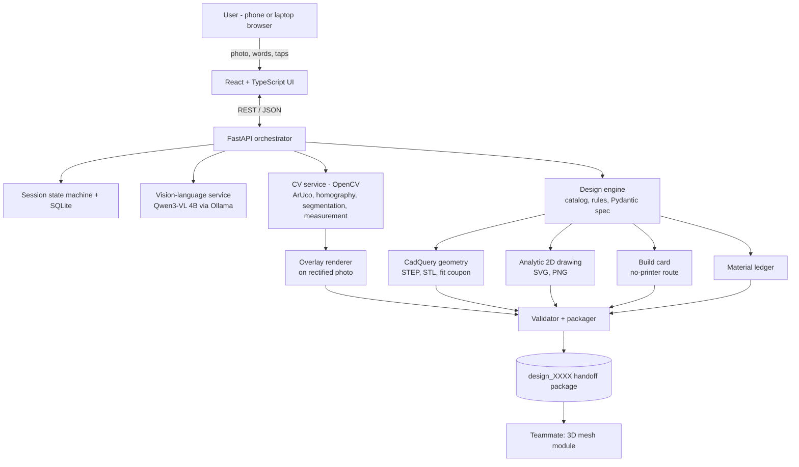

# ReFit — AI-Guided Adaptation & Repair of Everyday Objects

### Complete Project Blueprint v2.0 · Hackathon Edition · SDG 10 (Reduced Inequalities) + SDG 12 (Responsible Consumption & Production)

> **"ReFit" is a working title. Rename freely.**
> This is a planning and implementation document. Anything labelled **TARGET** or **ASSUMPTION** is a goal or an unverified starting value, not a result. Anything labelled **EVIDENCE** has a source in §22. Never present targets or assumptions as findings on stage.

---

## Table of Contents

0. Reader's guide, assumptions, what changed from v1
1. Executive summary
2. Problem and evidence
3. SDG alignment and impact claims
4. Landscape and differentiation
5. Product definition (personas, scope, journeys)
6. Feature catalogue and priority tiers
7. System architecture
8. Pipeline, stage by stage
9. Measurement system (the core technical contribution)
10. Data contracts (`design_spec.json` v1.0 and friends)
11. Design engine: catalog, rules, geometry
12. Outputs: drawing, overlay, build card, impact ledger
13. Implementation guide with code
14. Hardware and performance budget (RTX 5050 Laptop)
15. Safety, ethics, privacy, accessibility
16. Testing and evaluation plan
17. Hackathon execution plan (36 h)
18. Risk register
19. Demo script, pitch and judge Q&A
20. Handoff contract with the 3D-mesh teammate
21. Roadmap
22. References
A. Config and catalog files · B. Prompts · C. Glossary · D. Definition-of-done checklist

---

## 0. Reader's guide

### 0.1 Assumptions (change these if wrong)

| # | Assumption | Why it matters |
|---|---|---|
| A1 | Hackathon length ≈ 24–48 h; this plan is scheduled for **36 h** | Drives scope cuts in §17 |
| A2 | Team of **2**: you (vision, AI, design pipeline, UI) + teammate (3D mesh from your handoff) | Division in §20 |
| A3 | Laptop: **NVIDIA RTX 5050 Laptop GPU, 8 GB GDDR7 VRAM**, 16 GB system RAM, Windows | Model choice in §14. Confirm VRAM with `nvidia-smi` |
| A4 | A 3D printer may **not** be available to every user (or to you at the venue) | Motivates the no-printer build card (§12.3) |
| A5 | Judges are a mix of technical and impact reviewers | Demo needs both working software and honest evidence |
| A6 | All AI inference runs locally by default; a cloud VLM is a switchable demo fallback only | Privacy story + resilience |

### 0.2 What changed from the v1 blueprint

| v1 | v2 | Reason |
|---|---|---|
| Coin/card calibration as the main measurement route | **Printed Fit Sheet** (ArUco markers + gray work area + scale-check box) as the calibration target, plus a **manual-first measurement ladder** | A flat photo cannot see a handle's cross-section; markers on the sheet give a reliable plane and a quality score |
| "CadQuery SVG gives dimensioned drawings" | CadQuery used for **STEP/STL + geometry checks**; the **dimensioned SVG is generated analytically from the spec** | CadQuery's SVG exporter fits the shape into a requested image size and has no dimension annotation, so it cannot give 1:1 annotated drawings by itself (see §22) |
| Concept image by compositing onto the original perspective photo | Overlay drawn on the **rectified, millimetre-scaled** photo, optionally warped back | Makes the "overlay matches spec" check exact and cheap |
| SAM 2 + diffusion as options | Deferred. Classical CV + user-assisted region confirmation | Saves VRAM, time, and failure modes |
| Two categories, many design families | **One deep vertical (spoon grip sleeve)**, a narrow repair slice (drawer pull), others as parameter variants | Depth beats breadth in a live demo |
| SDG 10 only in practice | **Explicit SDG 10 + 12 design:** no-printer pathway, Re-fit, adapt-before-replace, computed material ledger | Judges scoring SDG fit need features, not slogans |
| Research-grade validation | Hackathon-grade evaluation (5–10 spoons with calipers, 30–50 VLM test images, 3-person usability check) | Feasible in 36 h and still evidence-based |

---

## 1. Executive summary

**One-liner.** Photograph an everyday object, say what is hard, and ReFit produces a **measured, safety-checked fix**: a printable part *or* a no-printer build card, so assistive products fit the person and repairable things stay out of the bin.

**Two streams, one pipeline.**

| Stream | Situation | Output | SDG |
|---|---|---|---|
| **Adapt** (primary) | Someone struggles to hold a utensil, pen, or similar object | A grip sleeve sized to *their* object and *their* difficulty | 10.2 |
| **Repair** (secondary, narrow) | A drawer pull is missing but the screw holes are visible | A replacement pull snapped to a standard hole spacing | 12.5 |

**Why it is different.** Parametric grip generators, Thingiverse designs and OT-oriented tools exist (§4). What they do not give a non-expert is a path from *a photo and a sentence* to *a measured, uncertainty-aware, safety-checked specification*, with an honest answer to "does it fit?". That path is the contribution.

**Three design principles.**
1. **Unknown until measured.** The system never invents a critical dimension. Missing or conflicting measurements downgrade the output to *concept only*.
2. **AI interprets; rules decide.** The vision-language model identifies the object and extracts the user's problem into a closed vocabulary. Design families, ranges, and rejections are deterministic and auditable.
3. **One spec, many outputs.** Geometry, drawing, overlay, build card, ledger and JSON are generated from one `design_spec.json` and carry the same hash.

**What we promise.** A calibrated, cross-checked estimate with stated error, a 10-minute fit-coupon check before the full print, and a handoff package for the 3D module.
**What we do not promise.** Guaranteed fit, medical suitability, food safety of printed plastics, or repair of hidden threads/clips.

---

## 2. Problem and evidence

All figures below are **EVIDENCE**; sources are in §22. Figures vary by study, population and definition, so quote ranges, not a single number.

### 2.1 Access gap (relevant to SDG 10)
- More than **2.5 billion** people need at least one assistive product; nearly **1 billion** are denied access; in low- and middle-income countries access can be as low as **3%** of need (WHO/UNICEF, 2022).
- The same report projects need rising to **3.5 billion by 2050** and notes about **two thirds** of users pay out of pocket; affordability is a major barrier.
- Children's products need frequent adjustment or replacement as they grow.

### 2.2 Abandonment (relevant to SDG 10 *and* 12)
- Roughly **30%** abandonment within a year is commonly used as the threshold between "low" and "high" abandonment (Italian national-health-service survey overview).
- A survey of **227 adults with disabilities** found **29.3%** of devices completely abandoned; factors included lack of user involvement in selection, poor performance, and changing needs.
- A small study of customised pediatric devices (**n = 27**) reported **37%** abandonment; hearing-aid abandonment as high as **78%** has been reported elsewhere.
- Improper fit to the user and the task is a recognised starting point for abandonment; a classic mismatch cause is treating needs as assessed only once.
- **Implication for design:** involve the user in choosing (2–3 options with reasons), prove fit before committing (coupon), and make re-sizing trivial (Re-fit).

### 2.3 Waste from small broken parts (relevant to SDG 12)
- In circular-economy thinking, repair is preferred over recycling; small household items are especially likely to be binned when one part fails.
- On-demand 3D-printed spares are in real use (a garden-furniture brand has printed over 1,000 foot caps), but a major corporate pilot reported mixed texture, colour and accuracy. **Do not oversell part quality.**

---

## 3. SDG alignment and impact claims

### 3.1 Target mapping

| SDG target | Wording (paraphrase) | How ReFit contributes | What we can legitimately measure |
|---|---|---|---|
| **10.2** | Promote social, economic and political inclusion of all irrespective of disability and other status | Lowers the skill, cost and clinic-access barrier to adapting everyday objects; supports independent daily living | Time-to-fit vs manual method, fit error (mm), proportion of tasks the user can do after adaptation (self-report), whether no-printer route is usable |
| **12.5** | Substantially reduce waste through prevention, reduction, recycling and reuse | Keeps existing objects in use (adapt/repair instead of replace); targets abandoned-device waste via better fit and re-fit | Items kept in use (count), grams of material used (computed), avoided replacement (user-entered) |

### 3.2 Honest framing (judges notice this)
- The **official 10.2 indicator is income-based** (share of people below 50% of median income, disaggregated by disability). ReFit does not move that indicator. Say "contributes to inclusion", not "reduces inequality by X%".
- The **official 12.5 indicator is a national recycling rate**, which does not capture repair or reuse. Say "contributes to the prevention/reuse part of target 12.5".
- Do **not** attach electronics e-waste statistics to handles and knobs.
- 3D printing has its own footprint. We answer with: print only what is needed, show grams used, offer a **no-printer** route, recommend printing a small coupon first.

### 3.3 Claims table

| Safe to say | Do not say |
|---|---|
| "About 30% of assistive devices are abandoned within a year in several studies; poor fit is a recurring cause." | "ReFit eliminates abandonment." |
| "We produce a calibrated estimate with stated error and a physical coupon test." | "Guaranteed fit." |
| "A no-printer build card lets people without a printer use the same measurement." | "Anyone can fabricate this anywhere." |
| "We show grams of material computed from the model volume." | Any CO₂ saving number (requires life-cycle data we do not have) |
| "Not a medical device; consult an occupational therapist." | "Clinically validated." |

---

## 4. Landscape and differentiation

| Existing work | What it does | Gap ReFit addresses |
|---|---|---|
| Thingiverse / MakerWorld assistive designs | Large libraries of community designs (e.g., writing aids) | User must find, measure, scale and judge safety alone |
| Makers Making Change | Open-source assistive designs with STL files and specification sheets | Static files; sizing and adaptation remain manual |
| GripFab (research tool) | Custom 3D-printed handgrips | Expects a design-literate user |
| Georgia Tech parametric tool for OTs | Parametric modification of adaptive handles because 3D-software learning curves block OTs | Targets clinicians; not a photo-to-spec flow for the public |
| MIT Style2Fab | Generative-AI personalisation of 3D-printable models without breaking function | Personalises style, not measured fit to an existing object |
| e-NABLE and similar maker networks | Large volunteer networks making printed assistive devices | Maker work can lack clinical training and risk awareness |

**Positioning sentence.** *"Templates exist. People can't measure, choose, or safety-check them. ReFit turns a photo and a sentence into a measured, uncertainty-aware specification, and tells you honestly how sure it is."*

---

## 5. Product definition

### 5.1 Illustrative personas (not real people)
- **Person with limited grip** (e.g., arthritis): wants to keep using a favourite spoon or pen; no CAD; may not own a printer; may prefer voice or very large buttons.
- **Helper** (caregiver, OT, volunteer maker): fits objects for someone else; wants speed and a record of what was measured and how.
- **Household repairer:** a drawer pull is missing; screw holes are visible; wants the right replacement size.

### 5.2 Scope

| In scope (demo) | Out of scope (stated as future work) |
|---|---|
| Spoon/fork/knife handles → **grip sleeve** | Medical diagnosis or clinical recommendations |
| Pen/pencil → grip variant (parameters only, if time) | Hidden threads, clips, internal fits |
| Drawer pull with **visible** screw holes (narrow slice) | Bill of materials, payments, marketplace |
| Fit Sheet, calibration, measurement fusion | Our own mesh-generation model |
| STEP + STL + fit coupon + SVG/PNG + JSON | Mechanical simulation / load analysis |
| No-printer build card | Diffusion-based photorealistic rendering |
| Computed grams ledger | CO₂ or cost-saving claims without data |

### 5.3 User journey (Adapt track)

1. **Choose track:** Adapt or Repair; choose language; consent notice (images stay on this machine by default).
2. **Show the object:** photo, or video frame, of the object *lying on the Fit Sheet*.
3. **Say what is hard:** type, speak, or tap an example.
4. **Confirm what we think we see:** "This looks like a **spoon**, problem area the **handle**. Correct?"
5. **One or two questions:** "Does it slip, hurt, or are your fingers unable to wrap around it?" Large buttons.
6. **Adapt-before-replace check:** "Your spoon can be adapted. Replacing it is not needed."
7. **Measure:** Fit Sheet photo (auto) → confirm handle region on the straightened image → paper-strip perimeter or manual number for thickness.
8. **See 2–3 options with reasons**, each marked *Verified / Cross-checked / Estimated / Concept only*.
9. **Pick one → results:** overlay image, dimensioned drawing, build card (no printer), STEP/STL (printer), fit coupon, grams ledger.
10. **Later:** *Re-fit* with changed needs or a new object, in one tap.

### 5.4 Repair track delta
Steps 4–7 change: the user photographs the drawer front with the Fit Sheet **held or taped flat against the face** (so the sheet and the holes share a plane); the app detects or asks for two hole centres; computes centre-to-centre distance; **snaps** to the nearest standard spacing if within tolerance; asks the user to confirm.

---

## 6. Feature catalogue and priority tiers

| Tier | Feature | SDG link | Notes |
|---|---|---|---|
| **P0** | Photo + text intake with quality gate | 10 | Blur / brightness / resolution checks |
| **P0** | VLM structured analysis (closed vocabulary) + user confirm | 10 | Never silently trust the model |
| **P0** | Slot-filling clarification (≤ 2 questions) | 10 | Deterministic question bank |
| **P0** | **Fit Sheet** PDF generator + ArUco calibration + rectification | 10 | Quality score from reprojection error |
| **P0** | Segmentation + **user-confirmed handle region** | 10 | Width profile along principal axis |
| **P0** | Measurement ladder (photo → paper-strip → manual → coupon) with fusion and uncertainty | 10 | Core contribution |
| **P0** | Grip-sleeve family (2–3 variants), CadQuery STEP/STL, **fit coupon** | 10, 12 | Coupon avoids wasted prints |
| **P0** | Analytic dimensioned SVG + PNG | 10 | 1:1 mm scale, spec hash |
| **P0** | Overlay on rectified photo + automatic dimension check | 10 | Labelled "illustrative" |
| **P0** | `design_spec.json` + validator + spec hash | all | Handoff contract |
| **P0** | **No-printer build card** (printable 1:1) | **10 (access)** | Foam tube / tape instructions with measured numbers |
| **P0** | **Material ledger** (grams from model volume) | **12** | Cost only if the user enters prices |
| **P0** | Disclaimers: not a medical device, food-contact note | 10 | Visible on every output |
| **P1** | Drawer-pull repair slice (visible holes, snap to standards) | **12** | Second demo path |
| **P1** | **Re-fit** (re-run parameters on saved spec) | **10, 12** | Targets "changing needs" abandonment cause |
| **P1** | **Adapt-before-replace** screen and reuse tally | **12** | Makes the hierarchy visible |
| **P1** | Voice input (browser speech) + one non-English UI language | 10 | See privacy note in §15 |
| **P1** | Cloud VLM fallback behind one interface | resilience | Env-flag switch |
| **P1** | 2-week check-in (mock or minimal) | 10 | "Still using it? What went wrong?" |
| **P2** | Pen family, knob family | — | Parameter variants |
| **P2** | SAM 2 click-segmentation, local Whisper | — | Only if memory allows |
| **P2** | Community library export, OT review export | 10 | Roadmap slide |

---

## 7. System architecture

### 7.1 Component diagram



### 7.2 ASCII fallback

```
Browser (React/TS) ──REST/JSON──► FastAPI ──► SQLite + local files
                                    │
        ┌───────────────┬───────────┼────────────────┬───────────────┐
        ▼               ▼           ▼                ▼               ▼
   Qwen3-VL 4B      OpenCV       Design engine    CadQuery       Renderers
   (Ollama)         ArUco/H,     catalog+rules    STEP/STL       SVG/PNG, overlay,
   JSON-schema      segment,     Pydantic spec    fit coupon     build card, ledger
   output           measure                                      
        └───────────────┴───────────┴────────────────┴───────────────┘
                                    ▼
                  Validator ► design_XXXX/ package ► teammate's 3D module
```

### 7.3 Responsibilities by layer

| Layer | Tech | Responsibility | Never does |
|---|---|---|---|
| UI | React + TypeScript, Vite | Capture, confirm, choose, view, download; large-target accessible UI | Compute dimensions |
| API | FastAPI, Pydantic v2 | Sessions, uploads, orchestration, state machine, serving built UI | Heavy compute in the request thread (use a worker thread for CV/CAD) |
| VLM | Qwen3-VL 4B Instruct via Ollama | Object, component, cross-section guess, problem slots | Measure, decide dimensions, rank by ergonomics |
| CV | OpenCV, NumPy, SciPy | Calibration, rectification, segmentation, width profile, hole detection | Infer hidden geometry |
| Design engine | Python + YAML catalog | Family selection, rule checks, parameter derivation, spec | Accept missing critical dimensions silently |
| Geometry | CadQuery (OpenCascade) | Solid, volume, bbox, STEP, STL, coupon | Annotate drawings |
| Rendering | SVG (hand-built), Pillow, PyMuPDF | Dimensioned drawing, overlay, build card, PNG export | Invent features absent from the spec |
| Validator | Pydantic + pytest-style checks | Consistency across outputs, status downgrade | — |

### 7.4 Session state machine

```
CREATED → ANALYZING → CONFIRMING_OBJECT → CLARIFYING → CALIBRATING → MEASURING
        → RECOMMENDING → DESIGN_SELECTED → GENERATING → READY
Side states: NEEDS_MORE_INFORMATION (returns to the failing step), FAILED (with reason), REFITTING (READY → MEASURING/RECOMMENDING)
```

Rules:
- A transition is allowed only if the previous step's **exit condition** holds (§8).
- `NEEDS_MORE_INFORMATION` always names the missing item in plain language.
- The state, answers already given, and measurement records persist in SQLite so questions are never repeated and Re-fit can reuse them.
- Concurrency: one active heavy task per session; a global lock around Ollama calls.

---

## 8. Pipeline, stage by stage

Format per stage: **Purpose · Input → Output · Method · Failure modes and fallbacks · Exit condition (testable).**

### S0 — Landing, track, language, consent
- **Purpose:** choose Adapt or Repair; set language; show a short privacy and safety notice.
- **Output:** `session` row with `track`, `lang`, `consent=true`.
- **Fallbacks:** none needed.
- **Exit:** consent recorded.

### S1 — Intake and quality gate
- **Input:** image (JPEG/PNG/HEIC) + optional free text.
- **Method:**
  1. Validate type and size (cap, e.g., 15 MB). Convert HEIC with `pillow-heif` if present.
  2. Apply EXIF orientation (`ImageOps.exif_transpose`), then **strip EXIF** from the stored/working copy (GPS etc.). Keep only `FocalLengthIn35mmFilm` in session metadata if present (used for the parallax estimate in §9.5).
  3. Quality checks: blur (variance of Laplacian), mean brightness, minimum resolution (long edge ≥ 1600 px **TARGET**), over-exposure fraction.
  4. Create a **VLM copy** resized to long edge ≤ 768 px.
- **Failure/fallback:** "Photo is blurry/dark. Tap to retake" with a lighting tip. Never proceed on a failed gate.
- **Exit:** `image.quality == "ok"`.

### S2 — Multimodal object understanding (VLM)
- **Input:** VLM copy + object vocabulary + user text.
- **Output:** `VlmAnalysis` (§13.2) with a closed vocabulary.
- **Method:** Qwen3-VL 4B Instruct through Ollama with a **JSON schema in `format`**, `temperature=0`, one retry on validation failure. Fields: `object`, `component`, `handle_end_side`, `cross_section_guess`, `visible_facts[]`, `inferences[]`, `confidence`. `visible_facts` and `inferences` are separate lists so the UI can show "what I see" vs "what I guess".
- **Failure/fallback:** invalid JSON after retry, or `object == "unknown"`, or `confidence == "low"` → ask the user to pick the object from big icon buttons.
- **Exit:** user taps **Confirm** (or corrects). *The VLM's output is never final without this tap.*

### S3 — Slot filling and clarification (deterministic)
- **Slots (Adapt):** `difficulty ∈ {slipping, pain, cannot_wrap_fingers, weak_grip, other}`, `hand_preference ∈ {left, right, either}` (affects only drawing orientation), `material_preference ∈ {soft, rigid, no_preference}`.
- **Method:** keyword rules fill slots from free text first; a text-only VLM call fills remaining slots; the **question bank** (Appendix A.4) asks only for missing slots, ≤ 2 questions, with large buttons plus "Not sure". Already-answered slots are never re-asked.
- **Rule:** the system never labels the user's condition. It records only the **functional difficulty the user reports**.
- **Exit:** all required slots filled or explicitly "not sure".

### S4 — Adapt-before-replace gate
- **Purpose:** make the circular-economy hierarchy visible and honest.
- **Rules:**
  - Object in catalog and component adaptable → "This can be adapted. No replacement needed."
  - Object not in catalog, or damage beyond catalog scope (hidden threads, cracked structure) → "ReFit can't safely help with this one. Here is what to ask a repair café / OT / shop." *Declining is a feature.*
- **Output:** `decision_path` record stored in the spec (supports the reuse tally).
- **Exit:** path chosen.

### S5 — Fit Sheet and capture guidance
- **Purpose:** get a photo that contains a trustworthy metric plane.
- **Fit Sheet:** an A4 PDF generated by the app (§9.2): 4 ArUco markers, a gray work area, a scale-check rectangle the size of an ISO ID-1 card (85.60 × 53.98 mm), a ruler, and a paper-strip ruler. User prints at **100% / Actual size** and checks the card against the rectangle.
- **Capture rules (shown as 3 pictograms):** object flat on the gray area, phone directly overhead at about arm's length, diffuse light, no hard shadows.
- **Quality score (automatic):** markers found (3–4), homography reprojection RMS in mm, estimated tilt, blur inside the work area.
- **Failure/fallback:** < 3 markers or RMS above threshold (**TARGET** ≤ 0.5 mm) → guided retake; after two failures → manual measurement route (S7 ladder still works).
- **Exit:** calibration object with `quality ∈ {good, acceptable}` **or** user chooses manual route.

### S6 — Rectify, segment, confirm region
- **Method:**
  1. Warp the photo to the sheet plane at **10 px/mm** → a 2100 × 2970 px "rectified" image in which pixel distances are millimetres (§13.4).
  2. Segment the object: estimate the background from the work-area border in Lab space, threshold ΔE (Otsu), morphological clean-up, largest connected component.
  3. Principal axis by PCA; **width profile** = object extent perpendicular to the axis, per 1 mm along it (§13.5).
  4. **Region confirm:** the UI shows the rectified image with a draggable bracket pre-placed on the narrow end; the user slides it over the part the sleeve will cover. This is the "user-assisted region" fallback built in from day one.
- **Failure/fallback:** poor mask (area ratio or solidity outside range) → user draws a coarse rectangle and the app runs GrabCut inside it.
- **Exit:** bracket confirmed; `handle_width` candidate with spread recorded.

### S7 — Measurement ladder and fusion
See §9 in full. **Exit:** every *critical* dimension has a record with `status ∈ {estimated, cross_checked, verified}` and a σ, or the session is marked `concept_only`.

### S8 — Recommendation (rules rank; AI does not decide)
- **Method:** deterministic `(object, difficulty) → ranked families/variants` from the catalog (§11.1). Hard rules **reject** options incompatible with measured geometry or flagged risks. Rationale text is **templated from the catalog** (optionally paraphrased by the VLM for tone, never for facts).
- **Output:** 2–3 `Proposal` objects: family, variant, rationale, parameters needed, mounting, limitations, missing info, feasibility, fit status.
- **Exit:** user selects one.

### S9 — Spec build and validation gate
- Build `design_spec.json` (§10). Run pre-generation validation (V1–V8, §10.5).
- **Gate:** if any *critical* dimension is `unknown` or `conflict`, set `verification_level = "concept"` and generate only the concept overlay and a **dimension-free** drawing with a banner; do **not** emit STEP/STL as "dimensioned".
- **Exit:** spec valid, `spec_hash` computed.

### S10 — Geometry (CadQuery) and fit coupon
- Build the solid from parameters; read `Volume()` and `BoundingBox()`; export **STEP** and **STL**.
- Build a **fit coupon**: a 10 mm slice of the sleeve with the same inner profile and slit. Print time is minutes; it lets the user check the fit before printing the full part.
- **Exit:** solid valid; bbox matches spec within 0.05 mm (**TARGET**).

### S11 — Dimensioned 2D drawing
- Analytic SVG from the spec: end view (cross-section), side elevation, top view; dimension lines in mm; title block with `design_id`, `spec_hash`, units, scale, `verification_level`; **warning banner** if not verified; export PNG via PyMuPDF (§13.7).
- **Exit:** every dimension printed in the SVG equals the spec value (checked by parsing the SVG's tagged dimension elements).

### S12 — Concept overlay
- Draw the sleeve onto the **rectified** photo at its confirmed location using a shaded top-down rendering, drop shadow, translucent "PROPOSED · ILLUSTRATIVE" tag. Optionally warp back to the original perspective for presentation (§13.8).
- **Exit:** overlay bounding box in pixels equals spec length × outer width × 10 within 1 px (automatic).

### S13 — Build card (no-printer route)
- A printable 1:1 sheet with the measured numbers: **foam tubing** (or similar) inner diameter to choose, cut length, tape wrap pattern, slit position, plus a cut-line template. Uses the same measurements and warnings. Wording uses **generic materials** and stresses testing for comfort and hygiene.
- **Exit:** card numbers equal spec values; 1:1 verification rectangle present.

### S14 — Material ledger
- Grams = volume × density × fill factor (§12.4). Cost shown **only** if the user enters filament price or alternative-product price. Always show assumptions.
- **Exit:** ledger present with assumptions list.

### S15 — Validate and package
- Run all validators (§10.5); write `validation_report.json`; assemble `design_XXXX/` (§10.6); show the **Verified / Cross-checked / Estimated / Concept only** badge.
- **Exit:** package written; report has no `error`-severity items.

### S16 — Re-fit
- User changes the object, a measurement, the difficulty, or the material. The app reloads the saved spec, re-runs S8–S15, and keeps provenance (`parent_design_id`).
- **Why it matters:** WHO notes growing children need frequent adjustments; AT-abandonment literature links abandonment to changing needs.

### Repair-track stages (R-S5…R-S7 replace S5–S7)
| Stage | Method | Fallback |
|---|---|---|
| R-S5 capture | Fit Sheet held/taped flat on the drawer face, photo straight on | Manual measurement with ruler |
| R-S6 hole detection | On the rectified image, `cv2.HoughCircles` within the region around the VLM's coarse location, or two user taps | User taps both hole centres |
| R-S7 spacing | centre-to-centre distance → snap to nearest of the standard list if within **±1.5 mm** (**ASSUMPTION**; tune in testing); ask the user to confirm | If no standard is within tolerance, keep the raw value, mark `estimated`, require manual confirmation |

Standard list (starting point; **verify for your region**): 32, 64, 76 (3 in), 96, 128, 160, 192, 224, 256 mm.

---

## 9. Measurement system (the core technical contribution)

### 9.1 Why measurement is the hard part
A photo taken from above shows a handle's **width** but not its **thickness** (the cross-section depth), yet a grip sleeve needs both. Depth-from-monocular-image models give plausible shapes, **not metrology**. ReFit therefore uses a **ladder of independent methods**, fuses them with uncertainty, and downgrades honestly.

### 9.2 The Fit Sheet (A4, printed at 100%)

All coordinates in mm, origin at top-left of the page, y downward.

| Element | Position / size | Purpose |
|---|---|---|
| ArUco markers, `DICT_4X4_50`, ids 0–3 | 30 × 30 mm squares at (12,12), (168,12), (12,255), (168,255) | Four-corner plane definition → homography; 16 corner points give an overdetermined fit and a quality score |
| Gray work area | e.g., 35% gray rectangle between the markers | Contrast with silver/white objects; stable background for segmentation |
| Scale-check rectangle | 85.60 × 53.98 mm, labelled "Place a bank/ID card here: edges should match" | User verifies print scale |
| Ruler | 0–150 mm along one edge, ticks every mm | Manual cross-check |
| Paper-strip ruler | 150 × 10 mm printed scale, cut-out guide | Perimeter measurement (§9.3, method C) |
| Footer | `ReFit Fit Sheet v1 · print at 100% · do not scale` | Avoids "fit to page" |

> Printer margins vary; markers sit 12 mm from the edges. If the scale-check box and a real card do not match within about 1 mm, the sheet was scaled. Reprint.

### 9.3 Methods ladder

| Method | What it gives | Typical σ (**ASSUMPTION**, to be replaced by §16 results) | Requires |
|---|---|---|---|
| **A. Photo on Fit Sheet** | Width (and length) in the sheet plane | ~0.3–0.6 mm | Printed sheet, one overhead photo |
| **B. Edge-on photo** *(optional)* | Thickness | ~0.8–1.5 mm | Second photo, flat card in the object's plane |
| **C. Paper-strip perimeter** | Cross-section perimeter → thickness (with A's width and a shape class) | ~1.0 mm on perimeter; thickness error depends on shape | Paper strip + printed scale |
| **D. Manual number** | Any dimension | User-entered; default σ = resolution of the instrument (e.g., 0.5 mm ruler; 0.05 mm caliper) | Ruler/caliper |
| **E. Fit coupon** | **Physical go/no-go** on the inner profile | verification, not an estimate | A 10-minute print (or the build-card equivalent) |

**Primary path for thickness:** C (paper strip) + A (width) → thickness, then cross-check with B or D if available.

### 9.4 Perimeter → thickness (shape-aware)

Given measured width *w* (method A), perimeter *P* (method C), and a cross-section class:

- **Ellipse:** `P ≈ π · [3(a+b) − √((3a+b)(a+3b))]`, with `a = w/2`, `b = t/2` (Ramanujan approximation).
- **Rounded rectangle** (corner radius *r*): `P = 2(w + t) − (8 − 2π)·r`.

Solve for *t* by a monotone root-find. The shape class comes from the VLM guess **confirmed by the user** (icons: round / oval / flat). Corner radius for the rounded rectangle is an **ASSUMPTION** (default 2–3 mm) included in σ by Monte-Carlo propagation (§13.6).

**Perimeter closure check:** if a thickness is also supplied by B or D, recompute the *predicted* perimeter and compare to C. A mismatch beyond tolerance flags **conflict** and asks for re-measurement. This is a cheap, three-way consistency test that is visible in the UI.

### 9.5 Error budget for the photo method

| Error source | Magnitude | Treatment |
|---|---|---|
| Marker localisation / homography fit | Reported as RMS (mm) over the 16 corner points | Quality gate; contributes σ₁ |
| **Height parallax:** a feature at height *h* above the sheet appears larger by *D/(D − h)*, *D* = camera height above the sheet | Example: *h* = 4 mm, *D* = 350 mm → ≈ 1.2% (≈ 0.17 mm on a 14 mm width) | Estimate *D* from marker size and EXIF `FocalLengthIn35mmFilm`: `f_px = f35 / 36 × image_width_px`, `D ≈ f_px × L_real / L_px`. Apply `w_true = w_app × (D − h)/D` with `h ≈ t/2`, or add as σ₂ if EXIF is missing |
| Lens distortion (not modelled by a homography) | Small near the image centre | Keep the object near the centre; flag if object touches image edges |
| Segmentation edge bias (shadows, specular rim) | ~1–3 px = 0.1–0.3 mm at 10 px/mm | Median over the confirmed bracket; σ from robust spread (IQR/1.35) |
| Print scale error | Detected by the scale-check rectangle | Block if > ~1 mm mismatch |

Total σ is the root-sum-square of independent terms.

### 9.6 Fusion rules

For each dimension with measurements *(xᵢ, σᵢ)*:
1. Two measurements **agree** if `|x₁ − x₂| ≤ min(1.5 mm, 2.5·√(σ₁² + σ₂²))` (**ASSUMPTION**, tune in testing).
2. Agreeing measurements fuse by **inverse-variance weighting**; fused σ = `1/√Σ(1/σᵢ²)`.
3. Disagreeing measurements → status **`conflict`** → ask the user to re-measure; never average silently.
4. Status ladder: `unknown` → `estimated` (one source) → `cross_checked` (≥ 2 agree) → `verified` (fit coupon passed or caliper-confirmed by user).
5. **Overall `verification_level`** is the minimum across *critical* dimensions: `concept` · `dimensionally_estimated` · `dimensionally_cross_checked` · `physically_verified`.

### 9.7 Design for tolerance, not for false precision
- Sleeves are **slit** and recommend a **flexible** material when σ_total > ~0.5 mm; rigid only when σ is small or the coupon passed.
- `clearance_mm` is increased with σ (rule in config, Appendix A.2).
- Export optionally **nominal and ±σ variants** of the coupon (three sizes) so the user can try the one that fits.
- The fit coupon is the final authority; the UI says so.

---

## 10. Data contracts

### 10.1 Principles
- **Single source of truth:** `design_spec.json`. Every output carries its `spec_hash`.
- **Provenance everywhere:** each measurement states its sources, method, σ, and who confirmed it.
- **Units explicit:** millimetres; a `coordinate_system` block makes axes unambiguous for the 3D teammate.
- **Versioned:** `schema_version` with a JSON Schema file both modules validate against.

### 10.2 `design_spec.json` v1.0 (illustrative example)

> **The numbers below are ILLUSTRATIVE placeholders, not measurements.** Real values appear only after calibration and confirmation.

```json
{
  "schema_version": "1.0.0",
  "design_id": "d_0001",
  "parent_design_id": null,
  "spec_hash": "sha256:<computed-after-canonicalisation>",
  "created_at": "2026-10-24T10:00:00Z",
  "_example": true,

  "track": "adapt",
  "object": {
    "type": "spoon",
    "component": "handle",
    "confirmed_by_user": true,
    "cross_section_class": "oval",
    "vlm": { "model": "qwen3-vl:4b-instruct", "confidence": "medium" }
  },

  "user_need": {
    "difficulty": "cannot_wrap_fingers",
    "free_text": "I can't wrap my fingers around this spoon",
    "preferences": { "material": "soft", "hand": "either" },
    "diagnosis_recorded": false
  },

  "decision_path": {
    "adapt_before_replace": true,
    "alternatives_considered": ["replace_with_commercial_adaptive_spoon"],
    "reason": "Handle is intact; adaptation possible"
  },

  "solution": {
    "family": "grip_sleeve",
    "variant": "contoured_large",
    "mounting": "slit_slide_on",
    "material_hint": "TPU_or_flexible",
    "no_printer_alternative": "foam_tube_build_card"
  },

  "measurements": {
    "unit": "mm",
    "handle_width":     { "value": 14.0, "sigma": 0.4, "status": "cross_checked",
                          "sources": ["photo_on_sheet", "manual_ruler"] },
    "handle_thickness": { "value": 7.0,  "sigma": 1.0, "status": "estimated",
                          "sources": ["paper_strip_perimeter"] },
    "handle_length_covered": { "value": 100.0, "sigma": 1.0, "status": "estimated",
                               "sources": ["user_bracket"] },
    "calibration": { "method": "aruco_sheet_v1", "reprojection_rms_mm": 0.31,
                     "markers_found": 4, "scale_check_passed": true }
  },

  "parameters": {
    "inner_width_mm": 14.4,
    "inner_thickness_mm": 7.4,
    "outer_width_mm": 30.0,
    "outer_thickness_mm": 26.0,
    "length_mm": 100.0,
    "wall_min_mm": 2.4,
    "slit_width_mm": 1.6,
    "clearance_mm": 0.4,
    "bulge_ratio": 1.15,
    "end_fillet_mm": 1.0
  },

  "coordinate_system": {
    "units": "mm",
    "origin": "centre_of_sleeve_start_face",
    "axes": { "x": "length, insertion direction", "y": "width", "z": "thickness (slit on +z)" }
  },

  "fit": {
    "verification_level": "dimensionally_estimated",
    "critical_dimensions": ["handle_width", "handle_thickness"],
    "coupon_file": "fit_coupon.stl",
    "coupon_result": null,
    "physical_fit_verified": false
  },

  "impact": {
    "material": "PETG",
    "volume_mm3": 0,
    "filament_g_est": 0,
    "fill_factor": 1.0,
    "assumptions": ["density from typical datasheet value", "thin walls print ~solid"]
  },

  "outputs": {
    "concept_image": { "file": "final_concept.png", "sha256": "<...>" },
    "drawing_svg":   { "file": "part_drawing.svg",  "sha256": "<...>" },
    "drawing_png":   { "file": "part_drawing.png",  "sha256": "<...>" },
    "step":          { "file": "part.step",         "sha256": "<...>" },
    "stl":           { "file": "part.stl",          "sha256": "<...>" },
    "build_card":    { "file": "build_card.pdf",    "sha256": "<...>" }
  },

  "disclaimers": [
    "Not a medical device. Consult an occupational therapist.",
    "Printed plastics are not food-safe by default; do not use on parts that touch food or mouth.",
    "Concept overlay is illustrative, not a photograph."
  ]
}
```

### 10.3 Measurement record (reusable)
```json
{
  "value": 14.0,
  "sigma": 0.4,
  "status": "estimated | cross_checked | verified | unknown | conflict",
  "sources": ["photo_on_sheet", "manual_ruler"],
  "measured_at": "ISO-8601",
  "confirmed_by_user": true,
  "notes": null
}
```

### 10.4 Canonical hash
`spec_hash = sha256(canonical_json(spec without {spec_hash, outputs, created_at}))`, where canonical JSON means sorted keys, no whitespace, UTF-8, floats rounded to 4 decimals. Every output (SVG title block, PNG tag, STEP header comment, ledger, build card) prints the **first 8 hex characters**.

### 10.5 Validation rules

| ID | Rule | Severity |
|---|---|---|
| V1 | All critical dimensions present with `status ∉ {unknown, conflict}` for a dimensioned export | error → downgrade to concept |
| V2 | All dimensions positive, within catalog min/max | error |
| V3 | `outer_* ≥ inner_* + 2·wall_min` on both axes (approximate along ellipse axes) | error |
| V4 | `clearance_mm` ≥ rule from σ_total | warning |
| V5 | Parameters match the selected family's schema | error |
| V6 | `scale_check_passed == true` when method A was used | error |
| V7 | CadQuery bbox equals spec length/outer dims within 0.05 mm | error |
| V8 | CadQuery volume within 2% of analytical estimate (when available) | warning |
| V9 | Every number printed in the SVG equals the spec value | error |
| V10 | Overlay pixel box equals spec × px/mm within 1 px | error |
| V11 | All outputs carry the same `spec_hash` prefix | error |
| V12 | Disclaimers present; no diagnosis field set | error |
| V13 | Build-card numbers equal spec values | error |
| V14 | Perimeter closure mismatch ≤ tolerance when ≥ 3 sources present | warning → conflict |

### 10.6 Handoff package

```
design_0001/
├── original_image.jpg          (EXIF-stripped working copy)
├── rectified_sheet.png         (10 px/mm, calibrated plane)
├── final_concept.png           (overlay, labelled illustrative)
├── part_drawing.svg            (1:1 mm, dimensioned)
├── part_drawing.png
├── part.step                   (parametric solid)
├── part.stl                    (mesh)
├── fit_coupon.stl              (10 mm slice for fit test)
├── build_card.pdf              (no-printer route, 1:1)
├── impact_ledger.json
├── design_spec.json
└── validation_report.json
```

---

## 11. Design engine

### 11.1 Catalog logic
- **Catalog** (YAML, Appendix A.1) lists families, variants, parameter ranges, mounting methods, applicable objects, rejection rules, rationale templates.
- **Ranking:** `(object, difficulty) → ordered list` from a mapping table; the VLM never ranks.
- **Hard rejections** (examples): thickness unmeasured → reject rigid sleeve; outer diameter beyond max for the user's stated hand preference → clamp; object in "mouth-contact" list → only handle-region proposals.

### 11.2 Starting mapping (**ASSUMPTION: validate with an OT or published ergonomics; not clinical guidance**)

| Reported difficulty | Variant emphasis | Material hint | Rationale template |
|---|---|---|---|
| Slipping | Textured/ribbed surface, moderate diameter | Soft/TPU or rigid with texture | "A textured, thicker grip gives your fingers more to hold." |
| Pain while gripping | Larger, smooth, no sharp ridges | Soft/TPU | "A wider, softer surface spreads pressure over more of your hand." |
| Cannot wrap fingers | Large diameter, optional palm support | Rigid or soft | "A larger grip means your fingers don't need to bend as far." |
| Weak grip | Larger diameter + friction surface | Soft | "A bigger, grippier surface needs less squeezing force." |
| Not sure | Offer 3 sizes of the same variant | Soft | "Try three sizes and keep the one that feels right." |

The user can adjust outer size within bounds via a slider; every result stays inside catalog min/max.

### 11.3 Families

**F1 — `grip_sleeve` (P0).** Slit, slide-on sleeve with elliptical inner profile (from measured width × thickness plus clearance) and elliptical outer profile (loft with optional bulge).
Parameters: `inner_width_mm`, `inner_thickness_mm`, `outer_width_mm`, `outer_thickness_mm`, `length_mm`, `wall_min_mm`, `slit_width_mm`, `clearance_mm`, `bulge_ratio`, `end_fillet_mm`.

**F2 — `drawer_pull_bar` (P1).** Straight bar with two screw bosses at the snapped centre-to-centre spacing.
Parameters: `hole_spacing_mm`, `hole_diameter_mm`, `bar_length_mm`, `bar_width_mm`, `bar_height_mm`, `standoff_mm`, `boss_diameter_mm`.
Caveats shown to the user: FDM layer direction matters; print so that layers are not the weakest direction under pulling load; this is for light-duty drawers.

**F3 — `pen_grip` (P2).** Same code path as F1 with different bounds and a shorter length.

### 11.4 Safety rules baked into the engine
- Utensils: **handle only**; refuse bowl/tines/mouth-contact surfaces; print the food-contact note on every output.
- No claims about load capacity for drawer pulls beyond "light-duty".
- Any dimension outside catalog bounds is rejected, not clamped silently.

---

## 12. Outputs

### 12.1 Dimensioned drawing
- Generated **analytically** from the spec (not from CadQuery's SVG exporter, which scales shapes to fit a requested image size and has no dimension annotation).
- Sheet: A4 landscape, `viewBox="0 0 297 210"` with `width="297mm" height="210mm"` so it prints at 1:1.
- Views: top (length × outer width), front (length × outer thickness), end/cross-section (outer ellipse, inner ellipse, slit gap), plus a notes block listing inner width/thickness, minimum wall, slit width and clearance.
- Each dimension text carries `data-dim="<spec_key>"` so the validator can parse and compare it to the spec (V9).
- Title block: `design_id`, `spec_hash[:8]`, units, scale, `verification_level`, date. Banner **"DIMENSIONS NOT FULLY VERIFIED — TEST WITH FIT COUPON"** unless `physically_verified`.
- Honest note printed on the sheet: *outline of the contoured sleeve is an analytic approximation of the CAD loft; bounding dimensions and wall limits are exact.*

### 12.2 Concept overlay
- Rendered on the **rectified** photo (10 px/mm). A shaded top-down sprite of the sleeve (cylinder-style shading across its width), rotated to the handle's principal axis, drop shadow, translucent, tag **"PROPOSED · ILLUSTRATIVE"**.
- Optional: warp the composite back to the original perspective with the inverse homography for a more natural look.
- If segmentation confidence is low, fall back to a side-by-side view (object photo | dimensioned silhouette).

### 12.3 No-printer build card (SDG 10 access feature)
Content, all computed from the spec:
1. **What you need:** foam tubing (or similar soft tube) with inner diameter ≥ `inner_*`; tape; scissors. *Generic materials only; no brand claims.*
2. **Cut length** = `length_mm`; **slit** along one side.
3. **Wrap pattern** (diagram): where to add tape layers to reach `outer_width_mm` / `outer_thickness_mm`.
4. **1:1 verification rectangle** and a cut-line template for the slit and ends.
5. Warnings: test comfort first; hygiene (not for the bowl or mouth contact); replace if worn.
6. Footer: spec hash, verification level, "not a medical device".

### 12.4 Material ledger
```
grams = (volume_mm3 / 1000) × density_g_per_cm3 × fill_factor
```
- Densities (**typical datasheet values; verify against your spool**): PLA ≈ 1.24, PETG ≈ 1.27, TPU ≈ 1.21 g/cm³.
- `fill_factor`: **1.0** for thin-walled sleeves (assume essentially solid; conservative upper bound); ~0.4–0.6 for bulkier parts with infill (**ASSUMPTION**, label as estimate).
- Cost lines appear **only** when the user enters filament price per kg and/or the price of the commercial alternative they would otherwise buy.
- No CO₂ numbers. State: "needs life-cycle data we do not have."
- Reuse tally: `items_kept_in_use += 1` when the user confirms the adaptation/repair path; shown as a count, not a claim of impact.

---

## 13. Implementation guide

### 13.1 Repository layout

```
refit/
├── README.md
├── docs/BLUEPRINT.md                  (this document)
├── frontend/                          Vite + React + TypeScript
│   └── src/{pages,components,api,i18n,types}
├── backend/
│   ├── main.py                        FastAPI app, serves built frontend
│   ├── config.py                      env, paths, thresholds
│   ├── api/                           sessions, uploads, analysis, measure, designs, exports
│   ├── ai/                            ollama_client.py, vision_analysis.py, slots.py
│   ├── vision/                        preprocess.py, fit_sheet.py, calibration.py,
│   │                                  segmentation.py, measurement.py, holes.py
│   ├── design/                        catalog.yaml, catalog.py, recommend.py, params.py, constraints.py
│   ├── geometry/                      sleeve.py, drawer_pull.py, coupon.py
│   ├── render/                        drawing.py, overlay.py, build_card.py, ledger.py
│   ├── export/                        spec.py, validator.py, package.py
│   ├── schemas/                       models.py, spec_v1.schema.json
│   └── storage/                       db.py (SQLite), files.py
├── tests/                             test_calibration.py, test_measurement.py, test_geometry.py,
│                                      test_drawing.py, test_validator.py
├── tools/                             benchmark_vlm.py, eval_measurement.py
├── sample_data/                       golden photos, sample packages
└── outputs/                           design_XXXX/ packages
```

### 13.2 Environment setup (Windows)

```powershell
# 1. GPU check
nvidia-smi                      # confirm "8192 MiB" total; note driver version

# 2. Ollama (native Windows installer from ollama.com), then:
ollama pull qwen3-vl:4b-instruct
ollama pull qwen3-vl:2b-instruct      # fallback; verify exact tags with `ollama list` / library page
ollama run qwen3-vl:4b-instruct "hello"
ollama ps                       # PROCESSOR column should say 100% GPU

# 3. Python env (3.11 recommended; confirm CadQuery wheel support for your version)
py -3.11 -m venv .venv
.venv\Scripts\activate
pip install fastapi "uvicorn[standard]" pydantic python-multipart pyyaml psutil ollama
pip install pillow pillow-heif numpy scipy opencv-contrib-python   # install only ONE opencv variant
pip install cadquery reportlab pymupdf pytest

# 4. Frontend
cd frontend; npm create vite@latest . -- --template react-ts; npm i; npm run build
```

Ollama environment variables (set before starting the Ollama server):

| Variable | Value | Reason |
|---|---|---|
| `OLLAMA_KEEP_ALIVE` | `30m` | Keep the model warm during judging |
| `OLLAMA_MAX_LOADED_MODELS` | `1` | One heavy model at a time |
| `OLLAMA_NUM_PARALLEL` | `1` | Avoid duplicated KV cache |
| `OLLAMA_FLASH_ATTENTION` | `1` | Lower memory use where supported |
| `OLLAMA_KV_CACHE_TYPE` | `q8_0` | Smaller KV cache (needs flash attention) |

### 13.3 Pydantic models for the VLM contract

```python
# backend/schemas/models.py
from typing import Literal
from pydantic import BaseModel, Field

ObjectT = Literal["spoon", "fork", "knife", "pen", "pencil", "toothbrush",
                  "zipper_pull", "drawer_handle", "knob", "cap", "unknown"]
ComponentT = Literal["handle", "grip_area", "stem", "body", "missing_part_site", "unknown"]
SideT = Literal["left", "right", "top", "bottom", "unknown"]
CrossT = Literal["round", "oval", "flat_rect", "unknown"]

class VlmAnalysis(BaseModel):
    object: ObjectT
    component: ComponentT
    handle_end_side: SideT                     # which side of the image the handle end is on
    cross_section_guess: CrossT
    visible_facts: list[str] = Field(default_factory=list, max_length=5)   # directly observed
    inferences: list[str] = Field(default_factory=list, max_length=5)      # guesses, labelled as such
    confidence: Literal["low", "medium", "high"]

class Measurement(BaseModel):
    value: float | None = None
    sigma: float | None = None
    status: Literal["unknown", "estimated", "cross_checked", "verified", "conflict"] = "unknown"
    sources: list[str] = Field(default_factory=list)
    confirmed_by_user: bool = False
```

### 13.4 VLM client

```python
# backend/ai/vision_analysis.py
import ollama
from pydantic import ValidationError
from schemas.models import VlmAnalysis

SYSTEM = (
    "You are a careful visual assistant for an object-adaptation tool. "
    "Describe ONLY what is visible. Put observations in visible_facts and guesses in inferences. "
    "Never guess a person's medical condition. If unsure, use 'unknown'. "
    "Return JSON matching the schema exactly."
)

class VlmFailure(RuntimeError): ...

def analyze(image_path: str, user_text: str,
            model: str = "qwen3-vl:4b-instruct", retries: int = 1) -> VlmAnalysis:
    schema = VlmAnalysis.model_json_schema()
    last = None
    for _ in range(retries + 1):
        resp = ollama.chat(
            model=model,
            messages=[
                {"role": "system", "content": SYSTEM},
                {"role": "user",
                 "content": f"The user says: {user_text!r}. Identify the object, the relevant component, "
                            f"which image side the handle end is on, and the likely cross-section.",
                 "images": [image_path]},
            ],
            format=schema,                                   # schema-constrained output
            options={"temperature": 0, "top_k": 20, "num_ctx": 4096, "num_predict": 400},
            keep_alive="30m",
        )
        try:
            return VlmAnalysis.model_validate_json(resp.message.content)
        except ValidationError as e:
            last = e
    raise VlmFailure(str(last))
```
Backend switch (cloud fallback): wrap `analyze` behind `VLM_BACKEND=ollama|cloud` in `config.py`; the cloud implementation must return the same `VlmAnalysis`. Never mix: either local or cloud per session, and tell the user which.

### 13.5 Fit Sheet generator

```python
# backend/vision/fit_sheet.py
import cv2
from PIL import Image
from reportlab.pdfgen import canvas
from reportlab.lib.units import mm
from reportlab.lib.utils import ImageReader

W, H, M, MS = 210.0, 297.0, 12.0, 30.0          # page, margin, marker size (mm)

def _marker(mid: int) -> Image.Image:
    ar = cv2.aruco
    d = ar.getPredefinedDictionary(ar.DICT_4X4_50)
    return Image.fromarray(ar.generateImageMarker(d, mid, 240))   # 6x6 cells (4x4 bits + border)

def _y(y_top: float, h: float = 0.0) -> float:                    # top-left mm -> reportlab bottom-left
    return (H - y_top - h) * mm

def build_fit_sheet(path: str) -> None:
    c = canvas.Canvas(path, pagesize=(W * mm, H * mm))
    # markers (ids 0..3 at TL, TR, BL, BR)
    pos = {0: (M, M), 1: (W - M - MS, M), 2: (M, H - M - MS), 3: (W - M - MS, H - M - MS)}
    for mid, (x, y) in pos.items():
        c.drawImage(ImageReader(_marker(mid)), x * mm, _y(y, MS), MS * mm, MS * mm)
    # gray work area
    c.setFillGray(0.62); c.rect(M * mm, _y(58, 189), (W - 2 * M) * mm, 189 * mm, stroke=0, fill=1)
    # scale-check rectangle (ISO ID-1 card) in lower-right of work area
    c.setStrokeGray(0.1); c.setDash(2, 2); c.setLineWidth(0.4)
    c.rect(112 * mm, _y(189, 53.98), 85.60 * mm, 53.98 * mm, stroke=1, fill=0); c.setDash()
    c.setFillGray(1); c.setFont("Helvetica", 7)
    c.drawString(114 * mm, _y(187), "Scale check: lay a bank/ID card here. Edges should match. Then remove it.")
    # 150 mm ruler inside work area
    c.setStrokeGray(1); c.setLineWidth(0.25)
    for i in range(0, 151):
        x = (20 + i) * mm; L = 4 if i % 10 == 0 else (3 if i % 5 == 0 else 1.5)
        c.line(x, _y(62), x, _y(62 + L))
        if i % 10 == 0: c.drawString(x - 2 * mm, _y(62 + 7.5), str(i))
    # paper-strip ruler (cut out): 150 x 10 mm above work area
    c.setStrokeGray(0); c.setFillGray(1); c.setLineWidth(0.3)
    c.rect(30 * mm, _y(45, 10), 150 * mm, 10 * mm, stroke=1, fill=1)
    c.setFillGray(0); c.setFont("Helvetica", 5)
    for i in range(0, 151):
        x = (30 + i) * mm; L = 3 if i % 10 == 0 else (2 if i % 5 == 0 else 1)
        c.line(x, _y(45), x, _y(45 + L))
        if i % 10 == 0 and i: c.drawString(x - 1.5 * mm, _y(45 + 6.5), str(i))
    c.setFont("Helvetica", 6)
    c.drawString(46 * mm, _y(43.5), "Cut out. Wrap around the handle, mark the overlap, lay flat, read the length.")
    c.setFont("Helvetica", 6); c.setFillGray(0)
    c.drawString(M * mm, 6 * mm, "ReFit Fit Sheet v1 · print at 100% (Actual size), do not 'fit to page' · not a medical device")
    c.showPage(); c.save()
```

> Marker corner positions in sheet coordinates (used by calibration): marker *k* at top-left `(x0, y0)` covers `(x0..x0+30, y0..y0+30)`. IDs/positions must match `pos` above.

### 13.6 Calibration: markers → homography → rectified image

```python
# backend/vision/calibration.py
import cv2, numpy as np
from dataclasses import dataclass

SHEET_W, SHEET_H, MARKER, MARGIN, PPM = 210.0, 297.0, 30.0, 12.0, 10   # PPM = rectified px per mm

class CalibrationError(RuntimeError): ...

def _corners_mm(mid: int) -> np.ndarray:
    x0 = MARGIN if mid in (0, 2) else SHEET_W - MARGIN - MARKER
    y0 = MARGIN if mid in (0, 1) else SHEET_H - MARGIN - MARKER
    return np.array([[x0, y0], [x0 + MARKER, y0], [x0 + MARKER, y0 + MARKER], [x0, y0 + MARKER]], np.float32)

@dataclass
class Calibration:
    H_img2mm: np.ndarray
    H_img2rect: np.ndarray
    rectified: np.ndarray
    rms_mm: float
    markers_found: int
    quality: str                      # good | acceptable | poor

def calibrate(img_bgr: np.ndarray) -> Calibration:
    ar = cv2.aruco
    det = ar.ArucoDetector(ar.getPredefinedDictionary(ar.DICT_4X4_50), ar.DetectorParameters())
    gray = cv2.cvtColor(img_bgr, cv2.COLOR_BGR2GRAY)
    corners, ids, _ = det.detectMarkers(gray)
    if ids is None:
        raise CalibrationError("No markers found")
    src, dst = [], []
    for c, i in zip(corners, ids.flatten()):
        if int(i) in (0, 1, 2, 3):
            src.append(c.reshape(4, 2)); dst.append(_corners_mm(int(i)))
    if len(src) < 3:
        raise CalibrationError(f"Only {len(src)} markers found; need at least 3")
    src = np.vstack(src).astype(np.float32); dst = np.vstack(dst)
    H, _ = cv2.findHomography(src, dst, 0)                         # least squares on all points
    proj = cv2.perspectiveTransform(src.reshape(-1, 1, 2), H).reshape(-1, 2)
    rms = float(np.sqrt(np.mean(np.sum((proj - dst) ** 2, axis=1))))
    S = np.diag([PPM, PPM, 1.0])
    H_rect = S @ H
    rect = cv2.warpPerspective(img_bgr, H_rect, (int(SHEET_W * PPM), int(SHEET_H * PPM)),
                               flags=cv2.INTER_LINEAR)
    quality = "good" if (rms <= 0.5 and len(src) == 16) else ("acceptable" if rms <= 1.0 else "poor")
    return Calibration(H, H_rect, rect, rms, len(src) // 4, quality)
```
Notes: (1) A homography cannot detect a **print-scale** error; the on-screen "card matches the box?" confirmation does. (2) Marker corner order from OpenCV is TL, TR, BR, BL of the *marker as printed*; do not rotate markers when printing. (3) Thresholds 0.5/1.0 mm are **TARGET/ASSUMPTION**; tune with §16 data.

### 13.7 Segmentation and width profile

```python
# backend/vision/segmentation.py
import cv2, numpy as np

ROI_MM = (12, 58, 198, 247)          # gray work area in sheet mm (x0, y0, x1, y1)

class SegmentationError(RuntimeError): ...

def segment(rect_bgr: np.ndarray, ppm: int = 10) -> np.ndarray:
    x0, y0, x1, y1 = [int(v * ppm) for v in ROI_MM]
    roi = rect_bgr[y0:y1, x0:x1]
    lab = cv2.cvtColor(roi, cv2.COLOR_BGR2LAB).astype(np.float32)
    k = 40
    border = np.concatenate([lab[:k].reshape(-1, 3), lab[-k:].reshape(-1, 3),
                             lab[:, :k].reshape(-1, 3), lab[:, -k:].reshape(-1, 3)])
    bg = np.median(border, axis=0)
    d8 = np.clip(np.linalg.norm(lab - bg, axis=2) * 4, 0, 255).astype(np.uint8)
    d8 = cv2.GaussianBlur(d8, (0, 0), 2)
    _, m = cv2.threshold(d8, 0, 255, cv2.THRESH_BINARY + cv2.THRESH_OTSU)
    ker = cv2.getStructuringElement(cv2.MORPH_ELLIPSE, (9, 9))
    m = cv2.morphologyEx(cv2.morphologyEx(m, cv2.MORPH_OPEN, ker), cv2.MORPH_CLOSE, ker)
    n, lbl, stats, _ = cv2.connectedComponentsWithStats(m)
    if n < 2:
        raise SegmentationError("No object found on the sheet")
    kbest = 1 + int(np.argmax(stats[1:, cv2.CC_STAT_AREA]))
    full = np.zeros(rect_bgr.shape[:2], np.uint8)
    full[y0:y1, x0:x1] = ((lbl == kbest) * 255).astype(np.uint8)
    return full

def width_profile(mask: np.ndarray, ppm: int = 10) -> dict:
    ys, xs = np.nonzero(mask)
    pts = np.column_stack([xs, ys]).astype(np.float64)
    c = pts.mean(0)
    evals, evecs = np.linalg.eigh(np.cov((pts - c).T))
    axis = evecs[:, int(np.argmax(evals))]
    perp = np.array([-axis[1], axis[0]])
    s, n = (pts - c) @ axis, (pts - c) @ perp
    bins = np.floor((s - s.min()) / ppm).astype(int)                 # 1 mm bins along the axis
    nb = int(bins.max()) + 1
    nmin, nmax = np.full(nb, np.inf), np.full(nb, -np.inf)
    np.minimum.at(nmin, bins, n); np.maximum.at(nmax, bins, n)
    ok = np.isfinite(nmin)
    return dict(s_mm=(np.arange(nb) + 0.5)[ok], width_mm=((nmax - nmin) / ppm)[ok],
                center_n_px=((nmax + nmin) / 2)[ok], axis=axis, perp=perp,
                origin=c, s_min_px=float(s.min()))

def handle_width(profile: dict, s0_mm: float, s1_mm: float, floor_sigma: float = 0.15):
    sel = (profile["s_mm"] >= s0_mm) & (profile["s_mm"] <= s1_mm)
    w = profile["width_mm"][sel]
    if w.size < 5:
        raise SegmentationError("Bracket too short")
    med = float(np.median(w))
    sigma = max(float(1.4826 * np.median(np.abs(w - med))), floor_sigma)
    return med, sigma
```
If the mask fails sanity checks (area ratio, solidity, touching the border), switch to user rectangle + `cv2.grabCut` on the rectified image.

### 13.8 Thickness from perimeter (with uncertainty)

```python
# backend/vision/measurement.py
import math, numpy as np
from scipy.optimize import brentq

def perim_ellipse(w, t):
    a, b = w / 2, t / 2
    return math.pi * (3 * (a + b) - math.sqrt((3 * a + b) * (a + 3 * b)))

def perim_rrect(w, t, r):
    r = min(r, w / 2, t / 2)
    return 2 * (w + t) - (8 - 2 * math.pi) * r

def solve_thickness(P, w, shape="ellipse", r=2.5):
    f = (lambda t: perim_ellipse(w, t) - P) if shape == "ellipse" else (lambda t: perim_rrect(w, t, r) - P)
    lo, hi = 1.0, 6 * w
    if f(lo) > 0 or f(hi) < 0:
        raise ValueError("Perimeter inconsistent with width")
    return brentq(f, lo, hi)

def thickness_mc(P, sP, w, sw, shape, n=2000, seed=0):
    rng = np.random.default_rng(seed); out = []
    for _ in range(n):
        try:
            out.append(solve_thickness(rng.normal(P, sP), rng.normal(w, sw), shape, rng.uniform(1.0, 4.0)))
        except ValueError:
            pass
    a = np.array(out)
    if a.size < n * 0.5:
        raise ValueError("Too many inconsistent samples")
    return float(np.median(a)), float(a.std())

def agree(x1, s1, x2, s2, k=2.5, abs_tol=1.5):
    return abs(x1 - x2) <= min(abs_tol, k * math.hypot(s1, s2))

def fuse(measures):
    """measures: list of (value, sigma). Inverse-variance fusion of mutually agreeing values."""
    w = np.array([1 / (s ** 2) for _, s in measures]); x = np.array([v for v, _ in measures])
    return float((w * x).sum() / w.sum()), float(1 / math.sqrt(w.sum()))
```

### 13.9 Geometry (CadQuery)

```python
# backend/geometry/sleeve.py
import cadquery as cq

def make_sleeve(p: dict) -> cq.Workplane:
    L = p["length_mm"]
    iw, it = p["inner_width_mm"], p["inner_thickness_mm"]
    ow, ot = p["outer_width_mm"], p["outer_thickness_mm"]
    wall, bulge = p["wall_min_mm"], p.get("bulge_ratio", 1.0)
    ew = max(ow / bulge, iw + 2 * wall); et = max(ot / bulge, it + 2 * wall)       # end sections
    outer = (cq.Workplane("YZ").ellipse(ew / 2, et / 2)
             .workplane(offset=L / 2).ellipse(ow / 2, ot / 2)
             .workplane(offset=L / 2).ellipse(ew / 2, et / 2)
             .loft(combine=True))                                                  # axis along +X
    inner = cq.Workplane("YZ").ellipse(iw / 2, it / 2).extrude(L)
    body = outer.cut(inner)
    slit = cq.Workplane("XY").box(L, p["slit_width_mm"], ot, centered=(False, True, False))
    return body.cut(slit)                                                          # slit on +Z side

def make_coupon(p: dict, length: float = 10.0) -> cq.Workplane:
    q = dict(p)
    q.update(length_mm=length, bulge_ratio=1.0,
             outer_width_mm=p["inner_width_mm"] + 2 * p["wall_min_mm"],
             outer_thickness_mm=p["inner_thickness_mm"] + 2 * p["wall_min_mm"])
    return make_sleeve(q)

def metrics(body: cq.Workplane) -> dict:
    s = body.val(); bb = s.BoundingBox()
    return {"volume_mm3": s.Volume(), "bbox_mm": (bb.xlen, bb.ylen, bb.zlen), "valid": s.isValid()}

def export(body, step_path, stl_path):
    cq.exporters.export(body, step_path)
    cq.exporters.export(body, stl_path, tolerance=0.05, angularTolerance=0.1)
```

```python
# backend/geometry/drawer_pull.py   (P1)
import cadquery as cq

def make_drawer_pull(p: dict) -> cq.Workplane:
    S, L = p["hole_spacing_mm"], p["bar_length_mm"]
    W, Hh = p["bar_width_mm"], p["bar_height_mm"]
    sd, bd, hd = p["standoff_mm"], p["boss_diameter_mm"], p["hole_diameter_mm"]
    bar = cq.Workplane("XY").box(L, W, Hh, centered=(True, True, False)).translate((0, 0, sd))
    pts = [(-S / 2, 0), (S / 2, 0)]
    bosses = cq.Workplane("XY").pushPoints(pts).circle(bd / 2).extrude(sd + Hh * 0.5)
    holes = cq.Workplane("XY").pushPoints(pts).circle(hd / 2).extrude(sd + Hh * 0.5)   # blind; size for self-tap or insert
    return bar.union(bosses).cut(holes)
```
Constraint: `bar_length_mm ≥ hole_spacing_mm + boss_diameter_mm + 2·wall`; hole diameter is an **ASSUMPTION**; test with a coupon.

### 13.10 Analytic dimensioned drawing

```python
# backend/render/drawing.py
import math

def _arrow(x, y, dx, dy, s=2.0):
    n = math.hypot(dx, dy); dx, dy = dx / n, dy / n
    px, py = -dy, dx
    pts = [(x, y), (x - dx * s + px * s * 0.3, y - dy * s + py * s * 0.3),
           (x - dx * s - px * s * 0.3, y - dy * s - py * s * 0.3)]
    return '<polygon points="%s" fill="black"/>' % " ".join(f"{a:.2f},{b:.2f}" for a, b in pts)

def dim_h(x1, x2, y, off, text, key):
    yy = y + off
    return "".join([
        f'<line x1="{x1}" y1="{y}" x2="{x1}" y2="{yy + 2}" stroke="black" stroke-width="0.15"/>',
        f'<line x1="{x2}" y1="{y}" x2="{x2}" y2="{yy + 2}" stroke="black" stroke-width="0.15"/>',
        f'<line x1="{x1}" y1="{yy}" x2="{x2}" y2="{yy}" stroke="black" stroke-width="0.2"/>',
        _arrow(x1, yy, -1, 0), _arrow(x2, yy, 1, 0),
        f'<text data-dim="{key}" x="{(x1 + x2) / 2}" y="{yy - 1.2}" font-size="3.2" '
        f'text-anchor="middle" font-family="Arial">{text}</text>'])

def dim_v(y1, y2, x, off, text, key):
    xx = x + off
    return "".join([
        f'<line x1="{x}" y1="{y1}" x2="{xx + 2}" y2="{y1}" stroke="black" stroke-width="0.15"/>',
        f'<line x1="{x}" y1="{y2}" x2="{xx + 2}" y2="{y2}" stroke="black" stroke-width="0.15"/>',
        f'<line x1="{xx}" y1="{y1}" x2="{xx}" y2="{y2}" stroke="black" stroke-width="0.2"/>',
        _arrow(xx, y1, 0, -1), _arrow(xx, y2, 0, 1),
        f'<text data-dim="{key}" x="{xx + 1.2}" y="{(y1 + y2) / 2}" font-size="3.2" '
        f'font-family="Arial">{text}</text>'])

def _profile(L, wmax, wend, ox, cy, n=40):
    """Closed outline: parabola from end size to max size (analytic approximation of the CAD loft)."""
    up, lo = [], []
    for i in range(n + 1):
        x = L * i / n; k = 1 - (2 * i / n - 1) ** 2
        w = wend + (wmax - wend) * k
        up.append((ox + x, cy - w / 2)); lo.append((ox + x, cy + w / 2))
    return " ".join(f"{a:.2f},{b:.2f}" for a, b in up + lo[::-1])

def _hline(x1, y1, x2, y2, dash=False, sw=0.2, col="gray"):
    d = ' stroke-dasharray="1.5,1"' if dash else ""
    return f'<line x1="{x1:.2f}" y1="{y1:.2f}" x2="{x2:.2f}" y2="{y2:.2f}" stroke="{col}" stroke-width="{sw}"{d}/>'

def sleeve_drawing(p: dict, meta: dict) -> str:
    L, ow, ot = p["length_mm"], p["outer_width_mm"], p["outer_thickness_mm"]
    iw, it, wall = p["inner_width_mm"], p["inner_thickness_mm"], p["wall_min_mm"]
    slit, bulge = p["slit_width_mm"], p.get("bulge_ratio", 1.0)
    ew, et = max(ow / bulge, iw + 2 * wall), max(ot / bulge, it + 2 * wall)
    ox, ty, fy, cx, cy = 25, 55, 130, 215, 90          # view origins (mm on the A4 landscape sheet)
    S = ['<svg xmlns="http://www.w3.org/2000/svg" width="297mm" height="210mm" viewBox="0 0 297 210">',
         '<rect width="297" height="210" fill="white"/>']
    # TOP VIEW (length x outer width): hidden inner width dashed, slit edges solid
    S += [f'<polygon points="{_profile(L, ow, ew, ox, ty)}" fill="none" stroke="black" stroke-width="0.35"/>',
          _hline(ox, ty - iw / 2, ox + L, ty - iw / 2, dash=True), _hline(ox, ty + iw / 2, ox + L, ty + iw / 2, dash=True),
          _hline(ox, ty - slit / 2, ox + L, ty - slit / 2, sw=0.25, col="black"),
          _hline(ox, ty + slit / 2, ox + L, ty + slit / 2, sw=0.25, col="black"),
          dim_h(ox, ox + L, ty + ow / 2, 8, f"{L:.1f}", "length_mm"),
          dim_v(ty - ow / 2, ty + ow / 2, ox + L, 8, f"{ow:.1f}", "outer_width_mm"),
          f'<text x="{ox}" y="{ty - ow / 2 - 4}" font-size="3" font-family="Arial">TOP VIEW</text>']
    # FRONT VIEW (length x outer thickness): hidden inner thickness dashed
    S += [f'<polygon points="{_profile(L, ot, et, ox, fy)}" fill="none" stroke="black" stroke-width="0.35"/>',
          _hline(ox, fy - it / 2, ox + L, fy - it / 2, dash=True), _hline(ox, fy + it / 2, ox + L, fy + it / 2, dash=True),
          dim_v(fy - ot / 2, fy + ot / 2, ox + L, 8, f"{ot:.1f}", "outer_thickness_mm__front"),
          f'<text x="{ox}" y="{fy - ot / 2 - 4}" font-size="3" font-family="Arial">FRONT VIEW</text>']
    # END VIEW (cross-section) with slit gap on the +z (top) side
    sx = slit / 2
    yo = (ot / 2) * math.sqrt(max(0.0, 1 - (sx / (ow / 2)) ** 2))
    yi = (it / 2) * math.sqrt(max(0.0, 1 - (sx / (iw / 2)) ** 2))
    S += [f'<ellipse cx="{cx}" cy="{cy}" rx="{ow / 2}" ry="{ot / 2}" fill="none" stroke="black" stroke-width="0.35"/>',
          f'<ellipse cx="{cx}" cy="{cy}" rx="{iw / 2}" ry="{it / 2}" fill="none" stroke="black" stroke-width="0.25"/>',
          f'<rect x="{cx - sx}" y="{cy - yo - 0.3}" width="{slit}" height="{yo - yi + 0.6}" fill="white"/>',
          _hline(cx - sx, cy - yo, cx - sx, cy - yi, sw=0.35, col="black"),
          _hline(cx + sx, cy - yo, cx + sx, cy - yi, sw=0.35, col="black"),
          dim_h(cx - ow / 2, cx + ow / 2, cy + ot / 2, 8, f"{ow:.1f}", "outer_width_mm__end"),
          dim_v(cy - ot / 2, cy + ot / 2, cx + ow / 2, 8, f"{ot:.1f}", "outer_thickness_mm"),
          f'<text x="{cx - ow / 2}" y="{cy - ot / 2 - 4}" font-size="3" font-family="Arial">END VIEW (slit on top)</text>']
    # NOTES block: inner size and other controlling values (each number carries data-dim for validation)
    notes = [("Inner width", "inner_width_mm"), ("Inner thickness", "inner_thickness_mm"),
             ("Minimum wall", "wall_min_mm"), ("Slit width", "slit_width_mm"), ("Clearance", "clearance_mm")]
    for i, (label, key) in enumerate(notes):
        y = 140 + i * 6
        S += [f'<text x="185" y="{y}" font-size="3.2" font-family="Arial">{label} (mm):</text>',
              f'<text data-dim="{key}" x="225" y="{y}" font-size="3.2" font-weight="bold" font-family="Arial">{p[key]:.1f}</text>']
    banner = ("" if meta["verification_level"] == "physically_verified" else
              '<text x="148.5" y="16" font-size="5" font-weight="bold" fill="#b00020" text-anchor="middle" '
              'font-family="Arial">DIMENSIONS NOT FULLY VERIFIED — TEST WITH FIT COUPON</text>')
    h8 = meta["spec_hash"].split(":")[-1][:8]
    S += [banner,
          f'<text x="10" y="200" font-size="3.2" font-family="Arial">{meta["design_id"]} · hash {h8} · units mm · '
          f'scale 1:1 · {meta["verification_level"]} · not a medical device</text>',
          '<text x="10" y="205" font-size="2.6" font-family="Arial">Outline is an analytic approximation of the CAD loft; '
          'bounding dimensions and wall limits are exact.</text>', '</svg>']
    return "".join(S)

def svg_to_png(svg_path: str, png_path: str, dpi: int = 200):
    import pymupdf as fitz                                   # or: import fitz
    doc = fitz.open(svg_path)
    doc[0].get_pixmap(dpi=dpi).save(png_path)
```
Validator V9 parses every `<text data-dim=…>` (a `__end`/`__front` suffix marks repeated dimensions) and compares to the spec. If PyMuPDF cannot render some SVG feature, fall back to `cairosvg` or a headless-browser screenshot.

### 13.11 Overlay renderer

```python
# backend/render/overlay.py
import cv2, numpy as np
from PIL import Image, ImageDraw, ImageFilter

def sleeve_sprite(length_mm, width_mm, ppm=10, radius_mm=4, color=(20, 150, 160)) -> np.ndarray:
    Lp, Wp = round(length_mm * ppm), round(width_mm * ppm)
    mask = Image.new("L", (Lp, Wp), 0)
    ImageDraw.Draw(mask).rounded_rectangle([0, 0, Lp - 1, Wp - 1], radius=int(radius_mm * ppm), fill=255)
    ys = np.linspace(-1, 1, Wp)[:, None]
    shade = 0.45 + 0.55 * np.sqrt(np.clip(1 - ys ** 2, 0, 1))
    rgb = np.broadcast_to(np.clip(np.array(color)[None, None, :] * shade[..., None], 0, 255), (Wp, Lp, 3))
    alpha = (np.array(mask) * 0.88).astype(np.uint8)
    return np.dstack([rgb.astype(np.uint8), alpha])           # shape (Wp, Lp, 4); size == spec x ppm (V10)

def place(rect_bgr, sprite, center_px, angle_deg):
    base = Image.fromarray(cv2.cvtColor(rect_bgr, cv2.COLOR_BGR2RGB)).convert("RGBA")
    sp = Image.fromarray(sprite, "RGBA").rotate(-angle_deg, expand=True, resample=Image.BICUBIC)
    sh = Image.new("RGBA", sp.size, (0, 0, 0, 0))
    sh.putalpha(sp.getchannel("A").point(lambda v: int(v * 0.5)))
    sh = sh.filter(ImageFilter.GaussianBlur(6))
    pos = (int(center_px[0] - sp.width / 2), int(center_px[1] - sp.height / 2))
    base.alpha_composite(sh, (pos[0] + 6, pos[1] + 8))
    base.alpha_composite(sp, pos)
    d = ImageDraw.Draw(base); d.text((pos[0], max(pos[1] - 20, 0)), "PROPOSED · ILLUSTRATIVE", fill=(255, 255, 255, 255))
    return base.convert("RGB")
```
Placement: `angle_deg = degrees(atan2(axis[1], axis[0]))` (image y-down); sleeve centre = `origin + axis·(s_min_px + s_mid_mm·ppm) + perp·median(center_n_px over the bracket)`.

### 13.12 Ledger, hash and validator

```python
# backend/render/ledger.py
DENSITY = {"PLA": 1.24, "PETG": 1.27, "TPU": 1.21}      # g/cm3, typical datasheet values; verify per spool

def filament_grams(volume_mm3: float, material: str, fill: float = 1.0) -> float:
    return volume_mm3 / 1000.0 * DENSITY[material] * fill
```

```python
# backend/export/spec.py
import hashlib, json

def _round(o):
    if isinstance(o, float): return round(o, 4)
    if isinstance(o, dict):  return {k: _round(v) for k, v in sorted(o.items())}
    if isinstance(o, list):  return [_round(v) for v in o]
    return o

def spec_hash(spec: dict) -> str:
    core = {k: v for k, v in spec.items() if k not in ("spec_hash", "outputs", "created_at")}
    blob = json.dumps(_round(core), sort_keys=True, separators=(",", ":"), ensure_ascii=False).encode()
    return "sha256:" + hashlib.sha256(blob).hexdigest()
```

```python
# backend/export/validator.py   (skeleton)
import re, xml.etree.ElementTree as ET

def validate(spec, metrics, svg_text, overlay_px, tol_bbox=0.05):
    issues = []
    P = spec["parameters"]
    def err(i, m): issues.append({"id": i, "severity": "error", "msg": m})
    for k in spec["fit"]["critical_dimensions"]:
        if spec["measurements"][k]["status"] in ("unknown", "conflict"):
            err("V1", f"{k} not usable")
    if P["outer_width_mm"] < P["inner_width_mm"] + 2 * P["wall_min_mm"] - 1e-6: err("V3", "wall too thin (width)")
    if P["outer_thickness_mm"] < P["inner_thickness_mm"] + 2 * P["wall_min_mm"] - 1e-6: err("V3", "wall too thin (thickness)")
    L, ow, ot = metrics["bbox_mm"]
    if abs(L - P["length_mm"]) > tol_bbox: err("V7", "length differs from CAD bbox")
    if abs(ow - P["outer_width_mm"]) > tol_bbox: err("V7", "outer width differs from CAD bbox")
    root = ET.fromstring(svg_text)
    for el in root.iter("{http://www.w3.org/2000/svg}text"):
        key = el.attrib.get("data-dim")
        if key:
            spec_key = key.split("__")[0]
            if abs(float(el.text) - P[spec_key]) > 0.05: err("V9", f"drawing {key} != spec")
    if abs(overlay_px[0] - P["length_mm"] * 10) > 1: err("V10", "overlay length px mismatch")
    if abs(overlay_px[1] - P["outer_width_mm"] * 10) > 1: err("V10", "overlay width px mismatch")
    return issues
```

### 13.13 FastAPI surface and state machine

| Method | Path | Purpose |
|---|---|---|
| POST | `/api/sessions` | Create session (track, language) |
| POST | `/api/sessions/{id}/image` | Upload object photo; quality gate |
| POST | `/api/sessions/{id}/analyze` | VLM analysis + slot extraction |
| POST | `/api/sessions/{id}/confirm-object` | User confirms/corrects object |
| POST | `/api/sessions/{id}/answers` | Clarification answers |
| GET | `/api/fit-sheet.pdf` | Generated Fit Sheet |
| POST | `/api/sessions/{id}/calibrate` | Sheet photo → rectified, mask, width profile |
| POST | `/api/sessions/{id}/region` | Confirm bracket → width measurement |
| POST | `/api/sessions/{id}/measurements` | Paper-strip / manual / caliper entries |
| GET | `/api/sessions/{id}/recommendations` | 2–3 proposals with rationale and status |
| POST | `/api/sessions/{id}/select` | Choose proposal (+ size slider within bounds) |
| POST | `/api/sessions/{id}/generate` | Geometry, drawing, overlay, card, ledger, validation |
| GET | `/api/designs/{id}/package.zip` | Handoff package |
| POST | `/api/designs/{id}/refit` | Re-fit with changes (new design, `parent_design_id` set) |
| GET | `/api/health` | Ollama reachable, model loaded, free VRAM |

```python
# backend/main.py (skeleton)
from enum import Enum
from fastapi import FastAPI, HTTPException
from fastapi.staticfiles import StaticFiles
from starlette.concurrency import run_in_threadpool
import threading

class S(str, Enum):
    CREATED="CREATED"; ANALYZING="ANALYZING"; CONFIRMING="CONFIRMING_OBJECT"; CLARIFYING="CLARIFYING"
    CALIBRATING="CALIBRATING"; MEASURING="MEASURING"; RECOMMENDING="RECOMMENDING"
    SELECTED="DESIGN_SELECTED"; GENERATING="GENERATING"; READY="READY"
    NEEDS_INFO="NEEDS_MORE_INFORMATION"; FAILED="FAILED"

ALLOWED = {S.CREATED:{S.ANALYZING}, S.ANALYZING:{S.CONFIRMING,S.NEEDS_INFO,S.FAILED},
           S.CONFIRMING:{S.CLARIFYING}, S.CLARIFYING:{S.CALIBRATING},
           S.CALIBRATING:{S.MEASURING,S.NEEDS_INFO}, S.MEASURING:{S.RECOMMENDING,S.NEEDS_INFO},
           S.RECOMMENDING:{S.SELECTED}, S.SELECTED:{S.GENERATING}, S.GENERATING:{S.READY,S.FAILED},
           S.READY:{S.MEASURING,S.RECOMMENDING}}      # re-fit
ollama_lock = threading.Lock()                         # one heavy inference at a time
app = FastAPI()

def move(session, new: S):
    if new not in ALLOWED.get(session.state, set()):
        raise HTTPException(409, f"Cannot go {session.state} -> {new}")
    session.state = new

@app.post("/api/sessions/{sid}/analyze")
async def analyze_ep(sid: str):
    ...   # load session, move(ANALYZING); with ollama_lock: await run_in_threadpool(analyze, path, text)

# serve the built UI last
app.mount("/", StaticFiles(directory="frontend/dist", html=True), name="ui")
```
Run on the LAN so a phone can upload: `uvicorn backend.main:app --host 0.0.0.0 --port 8000`, then open `http://<laptop-ip>:8000` on the phone (same Wi-Fi/hotspot; allow the port in Windows Firewall).

### 13.14 Frontend notes (React + TypeScript)

- **Pages:** `Capture` (track, photo, text/voice), `Confirm` (what we see; questions), `Measure` (Fit Sheet photo, rectified image + draggable bracket, strip/manual inputs, badges), `Results` (options → outputs, ledger, downloads, Re-fit).
- **Camera:** use `<input type="file" accept="image/*" capture="environment">`. It works over plain HTTP on a LAN; `getUserMedia` requires HTTPS.
- **Voice:** browser speech recognition (e.g., `webkitSpeechRecognition` in Chromium) is convenient but typically **sends audio to a cloud service**, which conflicts with the local-first claim. Label it clearly, make it optional, always offer buttons. A local Whisper model is a P2 option and competes for memory.
- **Accessibility rules:** tap targets ≥ 48 px; text contrast ≥ 4.5:1; base font ≥ 18 px; every control labelled for screen readers; `aria-live` for progress; no time limits; one task per screen; no colour-only status (badge text + icon).
- **Status badge component:** `Verified · Cross-checked · Estimated · Concept only` with plain-language tooltips.
- **i18n:** a JSON dictionary per language; ship English + one other. The VLM prompt stays English; UI text is translated.
- **State:** React Query for server state; the server holds the authoritative session.

---

## 14. Hardware and performance budget (RTX 5050 Laptop · 8 GB VRAM · 16 GB RAM)

### 14.1 Facts and estimates

| Item | Value | Basis |
|---|---|---|
| GPU | RTX 5050 Laptop, **8 GB GDDR7**, 128-bit bus | Manufacturer/press specifications (laptop version; the desktop card uses GDDR6) |
| Power | Laptop TGP varies by model (roughly 50–115 W configurations) | Press reports; performance depends on cooling and power mode |
| Qwen3-VL sizes | 2B, 4B, 8B (plus larger) | Model listings |
| Quantised weights | ≈ 3.3 GB (4B), ≈ 6.1 GB (8B) | Third-party GGUF listing; **verify** |
| Peak VRAM for 4B incl. vision projector, KV cache, activations | **ASSUMPTION ≈ 4.5–6 GB** | Replace with measured value (§14.3) |
| 8B on this GPU | Likely too tight with Windows desktop VRAM use | Avoid unless benchmark shows headroom |

**Decision:** default `qwen3-vl:4b-instruct`; fallback `qwen3-vl:2b-instruct`; do not run SAM 2, diffusion or local Whisper alongside it in the MVP.

### 14.2 Runtime memory plan (to be replaced by measurements)

| Component | Device | Expected footprint (**ASSUMPTION**) | Note |
|---|---|---|---|
| Ollama + Qwen3-VL 4B | GPU (+ some system RAM) | 4.5–6 GB VRAM | Keep context 4096; images ≤ 768 px |
| FastAPI + OpenCV + SciPy | CPU | 0.5–1 GB RAM | Single worker |
| CadQuery / OCP | CPU | 0.3–0.8 GB RAM during builds | Build in a worker thread; release after |
| Browser + React UI | CPU | 1–2 GB RAM | Serve the **built** UI, not the dev server |
| Windows + background | CPU | Reduce | Earlier observation: about 13 GB of 16 GB in use. Identify the hog (browser tabs, Docker/WSL, launchers) and close it before demos |

### 14.3 Go/no-go benchmark (Hour 0–2)

```python
# tools/benchmark_vlm.py
import glob, json, subprocess, time, psutil, ollama
from backend.ai.vision_analysis import analyze

def vram_mb():
    out = subprocess.check_output(["nvidia-smi", "--query-gpu=memory.used",
                                   "--format=csv,noheader,nounits"]).decode().splitlines()[0]
    return int(out)

rows = []
for model in ["qwen3-vl:2b-instruct", "qwen3-vl:4b-instruct"]:
    v0 = vram_mb()
    for i, path in enumerate(sorted(glob.glob("sample_data/bench/*.jpg"))[:20]):
        t = time.time()
        try:
            a = analyze(path, "I find this hard to hold", model=model); ok = True
        except Exception as e:
            a, ok = None, False
        rows.append(dict(model=model, img=path, ok=ok, sec=round(time.time() - t, 2),
                         vram_mb=vram_mb(), ram_gb=round(psutil.virtual_memory().used / 1e9, 2),
                         obj=getattr(a, "object", None)))
json.dump(rows, open("outputs/benchmark.json", "w"), indent=2)
```

**Pass criteria (TARGETS):** JSON valid ≥ 95%; warm latency ≤ 15 s per image; peak VRAM ≤ 7 GB (≥ 1 GB headroom); system RAM stays below ~14 GB. If the 4B fails, use 2B; if both fail, switch `VLM_BACKEND=cloud` for the demo and disclose it.

### 14.4 Operating checklist before judging
1. Plugged in; Windows power mode "Best performance"; GPU not throttling.
2. `ollama ps` shows the model resident on 100% GPU; first request already warmed.
3. Only: Ollama, backend, one browser window. Everything else closed.
4. `GET /api/health` is green.
5. Offline mode check: Wi-Fi off (except the phone link) and one full run still works.
6. Cached "golden session" ready as a clearly labelled replay (never presented as live).

### 14.5 Performance targets (**TARGETS**)

| Step | Target |
|---|---|
| VLM analysis (warm) | ≤ 15 s |
| Calibration + rectify + segment + profile | ≤ 3 s |
| Geometry + STEP/STL | ≤ 5 s |
| Drawing + PNG | ≤ 2 s |
| Overlay + build card + ledger | ≤ 3 s |
| **End-to-end after last user input** | **≤ 30 s** |

---

## 15. Safety, ethics, privacy, accessibility

### 15.1 Safety and scope
| Topic | Rule |
|---|---|
| Medical | Not a medical device. No diagnosis and no `diagnosis` field. The system records only the **functional difficulty the user reports**. Every output carries "consult an occupational therapist". People with severe pain, progressive conditions or swallowing/safety concerns should see a professional |
| Food and mouth contact | Printed plastics are not food-safe by default (porosity, layer lines, additives). Utensil proposals cover the **handle only**; refuse bowl/tines/mouth-contact parts; state this on every output |
| Skin contact and hygiene | Recommend smooth surfaces, no sharp edges; advise cleaning and inspection; mention that some people react to certain materials |
| Small parts | Knobs/caps can be choking hazards for young children; show a warning for that family |
| Mechanical | Drawer pulls: "light-duty only"; layer direction affects strength; no load claims |
| Overconfidence | The UI states `verification_level` in words. The **fit coupon is the authority** on fit |
| Declining | When the object or damage is out of scope, the app says so and suggests a repair café / OT / shop |

### 15.2 Privacy (local-first)
- Photos and sessions stay on the machine by default. EXIF (including GPS) is stripped from stored copies.
- No faces required; the capture instructions ask for the object only. If a face or hand with identifying features is detected by the user, they can retake.
- Consent screen explains storage; **Delete session** removes files and database rows.
- **Voice:** browser speech recognition often uses a cloud service. Label it, make it optional, never default-on.
- **Cloud VLM fallback:** disclose before use; send only the resized object photo and text; never store keys in the repo.

### 15.3 Fairness, inclusion, accessibility
- Design for people who do not read English fluently, have low vision, or cannot hold a phone steadily: icons plus text, voice optional, large controls, one task per screen.
- The no-printer card keeps the benefit available where printers are not.
- Avoid assuming that the same condition implies the same need; offer sizes and let the user choose.
- Evidence of lived-experience input (even one conversation with an OT, carer or user) should be named in the pitch, not implied.

### 15.4 Licensing and attribution (**verify before release**)
Check licences of Qwen3-VL (reported Apache-2.0), CadQuery, OpenCV, reportlab, PyMuPDF (**note: PyMuPDF is AGPL/commercial dual-licensed; fine for an open-source hackathon repo, review for later use**). Consider releasing generated designs under an open licence (e.g., CC-BY) so makerspaces can reuse them.

---

## 16. Testing and evaluation plan

Tables below are **templates**. Fill them with your measured results; never present a template as a result.

### 16.1 Test objects
- **Spoons/utensils:** 8–10 handles with different widths and cross-sections (round, oval, flat), including at least one glossy silver, one dark, one plastic.
- **Drawer pulls (P1):** 3–5 drawers with different standard spacings.
- **Photos:** each object photographed 3 times at different heights/angles/lighting.

### 16.2 E1 — VLM object/component accuracy (30–50 images)
| Metric | Target | Result |
|---|---|---|
| Valid JSON after ≤ 1 retry | ≥ 95% | |
| Object accuracy (closed vocabulary) | ≥ 90% | |
| Component accuracy | ≥ 85% | |
| Cross-section guess accuracy | report only | |
| Share requiring user correction | report | |
Report a small confusion matrix and the failure examples.

### 16.3 E2 — Measurement accuracy (the headline evidence)
**Ground truth:** digital caliper, 3 positions along the covered region, average. **Photos:** 3 per object.
| Method | Dimension | n | Mean abs error (mm) | Max error (mm) | Bias (mm) | % within ±1 mm |
|---|---|---|---|---|---|---|
| A. Photo on Fit Sheet | width | | | | | |
| C. Paper strip + A | thickness | | | | | |
| D. Manual ruler | width / thickness | | | | | |
| Fused (A+D) | width | | | | | |
Also report: repeatability (SD across the 3 photos), effect of camera height, effect of lighting, calibration RMS vs actual error (is RMS predictive?).
**Targets (ASSUMPTION):** width MAE ≤ 0.5 mm; thickness MAE ≤ 1.5 mm; if missed, say so and show that the **tolerance-aware design + coupon** still absorbs the error.

### 16.4 E3 — Output consistency (automatic)
| Check | Target | Result |
|---|---|---|
| V9 drawing values equal spec | 100% | |
| V10 overlay pixel box equals spec × 10 within 1 px | 100% | |
| V7 CAD bbox equals spec within 0.05 mm | 100% | |
| V11 all outputs carry the same hash | 100% | |

### 16.5 E4 — Fit coupon trials
Print coupons for ≥ 5 objects (nominal and ±σ variants). Record: fits snugly / loose / too tight, and which variant. Report **first-try fit rate** honestly, including failures.

### 16.6 E5 — Mini usability check (3 people; no statistical claims)
Task: "make a grip sleeve spec for this spoon." Compare (a) ruler + choosing a downloaded template and scaling it vs (b) ReFit. Record time, errors, confusion points, and a 1–5 ease rating. Ask one question: "Would you use the no-printer card?" If possible include one OT or carer.

### 16.7 E6 — Performance (from §14.3 benchmark)
Report model, VRAM peak, RAM peak, latency per stage, end-to-end time.

### 16.8 Unit/integration tests (pytest)
| File | Covers |
|---|---|
| `test_calibration.py` | Synthetic sheet image with known homography → recovered mm positions within 0.2 mm; missing markers raise |
| `test_measurement.py` | Perimeter↔thickness round trip; fusion; agreement rules; conflict detection |
| `test_geometry.py` | Bbox/volume vs analytic; wall rule; coupon dims |
| `test_drawing.py` | Every `data-dim` equals spec; banner present when not verified |
| `test_validator.py` | Each V-rule triggers on a corrupted spec |
| `test_golden.py` | 3 golden sample packages validate against `spec_v1.schema.json` |

---

## 17. Hackathon execution plan (36 h, 2 people)

### 17.1 Roles
- **You:** vision, AI, design engine, UI, evaluation.
- **Teammate:** 3D mesh pipeline from `part.step`/`part.stl`, viewer integration; also owns printing logistics and the physical demo prop.

### 17.2 Timeline

| Hours | You | Teammate | Exit criterion |
|---|---|---|---|
| 0–2 | Repo, env, **benchmark (§14.3)**, `nvidia-smi`/`ollama ps` | Review spec; set up mesh environment | Model choice made from data |
| 2–4 | Freeze `design_spec.json` v1.0 + JSON Schema + 1 sample package; **print Fit Sheet** | Confirm STEP vs STL input, axes | Schema agreed in writing |
| 4–9 | **Calibration + rectify + segmentation + width profile** on real photos (riskiest first) | Prototype ingest of sample STEP | 5 real photos give plausible widths |
| 9–13 | Bracket UI, paper-strip entry, manual entry, fusion, badges | — | Width + thickness with σ and status |
| 13–17 | VLM client, schema output, confirm screen, slot filling | Mesh pipeline v0 | Object confirmed from a photo |
| 17–21 | CadQuery sleeve, coupon, STEP/STL; **first physical print starts** | Receives STEP | Coupon printing |
| 21–25 | Analytic drawing, validator, spec hash, package builder | Viewer wiring | V1–V13 passing |
| 25–28 | Overlay, build card, ledger, results page | Polish viewer | One full run end-to-end |
| 28–31 | **E2 measurement eval** (5+ spoons), E1 on 30 images, coupon fit test | Print/finish demo prop | Real numbers recorded |
| 31–33 | Drawer-pull slice **or** Re-fit (pick one; Re-fit preferred if behind) | Rehearsal support | One stretch feature works |
| 33–36 | Rehearse, record backup video, build slides, golden session | Same | Full rehearsal passes twice |

### 17.3 Cut lines (decide early; no heroics)
| At | If | Then |
|---|---|---|
| H13 | Photo width unreliable (RMS or error too high) | Make manual + paper-strip the primary route; keep photo as cross-check |
| H17 | VLM too slow/unstable | Use 2B or cloud fallback; keep user object selection prominent |
| H25 | Overlay not convincing | Side-by-side view + labelled silhouette |
| H28 | Behind schedule | Drop drawer pull; keep Re-fit as a mock screen **labelled as mock** |
| Always | Demo risk | Recorded backup video + labelled replay session |

---

## 18. Risk register

| ID | Risk | L | I | Mitigation | Trigger |
|---|---|---|---|---|---|
| R1 | Cross-section thickness not measurable from photo | H | H | Measurement ladder; paper strip; manual; coupon | Thickness σ > 1.5 mm |
| R2 | Silver/white utensils segment poorly | M | H | Gray work area, Lab ΔE threshold, user bracket, GrabCut fallback | Mask area/solidity outside range |
| R3 | Print-scale error on the Fit Sheet | M | H | Scale-check rectangle with explicit user confirmation | "Card doesn't match" |
| R4 | Height parallax / lens distortion | M | M | Overhead capture, parallax correction/σ, centre placement | Marker spacing implies D < 250 mm |
| R5 | Small VLM misclassifies or breaks JSON | M | M | Schema-constrained output, one retry, user confirmation, closed vocabulary | JSON fail > 5% |
| R6 | 8 GB VRAM / 16 GB RAM pressure | M | H | 4B model, ctx 4096, one model, close apps, 2B fallback | VRAM peak > 7 GB |
| R7 | Live demo failure | M | H | Backup video, labelled replay, cloud fallback flag | Any crash in rehearsal |
| R8 | Print time/quality blocks the physical demo | M | H | Print coupon first; start print by H21; no-printer card as plan B | Printer unavailable |
| R9 | Overclaiming SDG impact | M | H | §3.3 claims table; use computed/measured numbers only | Any unsourced number on a slide |
| R10 | Safety criticism (food contact, medical) | M | M | Handle-only rule, disclaimers, OT consult line | Judge question |
| R11 | CadQuery install issues on Windows | L–M | M | Pin Python 3.11, test import in H0–2; fall back to analytic geometry + trimesh for STL | Import fails |
| R12 | PyMuPDF SVG render quirks | L | L | Keep SVG simple (inline attributes); fallback cairosvg/browser | Blank PNG |
| R13 | Schema drift with teammate | M | H | Frozen schema, golden samples, shared validator | Any field change |

---

## 19. Demo script, pitch and judge Q&A

### 19.1 Four-minute demo
| Time | Beat | Show |
|---|---|---|
| 0:00 | **Story** | One person, one spoon they cannot hold; "30% of assistive devices are abandoned within a year in several studies; poor fit is a common reason" |
| 0:30 | **Capture** | Spoon on the printed Fit Sheet; photo; "I can't wrap my fingers around it" |
| 0:50 | **Understanding** | "I see a spoon, handle at the left. Correct?" (tap); one question; adapt-before-replace message |
| 1:20 | **Measurement** | Rectified image, bracket slide, paper-strip number, badges: *Width 14.0 ± 0.4 mm (cross-checked)*, *Thickness 7 ± 1 mm (estimated)* |
| 1:50 | **Options** | 2–3 proposals with reasons; user picks one with the size slider |
| 2:15 | **Outputs** | Overlay (labelled illustrative), dimensioned drawing with hash, build card, ledger "X g PETG (computed)" |
| 2:45 | **Prove it** | Physical coupon sliding onto the real handle; printed sleeve if available; **no-printer card** version |
| 3:15 | **Evidence** | One slide: measurement error table (E2), VLM accuracy (E1), runs on a laptop GPU with measured memory |
| 3:40 | **Honest limits + roadmap** | Hidden fits, OT validation, more families; SDG 10.2 and 12.5 contribution wording |
| 4:00 | Close | "Templates exist; people can't measure or safety-check them. ReFit does, and tells you how sure it is." |

### 19.2 Slide outline (8 slides)
1. Problem (access gap + abandonment) 2. Idea (two streams, one pipeline) 3. Demo (screens) 4. How it works (architecture + measurement ladder) 5. Evidence (E1/E2/E4 tables) 6. SDG mapping + honest claims 7. Safety and ethics 8. Roadmap + ask.

### 19.3 Judge Q&A

| Question | Answer |
|---|---|
| Isn't this on Thingiverse? | Designs exist; sizing, choosing and safety-checking remain manual. We automate the measured fit and state uncertainty. Tools like GripFab or OT-oriented parametric tools expect design literacy. |
| How accurate is it? | Show E2: mean/max error per method, and that the **coupon** is the final check. Mention what failed. |
| Does the AI decide the design? | No. The VLM identifies the object and extracts the problem. Rules, ranges and rejections decide; the user confirms. |
| What if you cannot print? | The build card uses the same measurements with foam tubing and tape. |
| Is it safe? | Handle-only for utensils, not food-safe by default, not a medical device, OT consult, declining out-of-scope cases. |
| How does this help SDG 10? | Lowers the skill, cost and clinic-access barrier to adapting everyday objects. We contribute to inclusion; we do not claim to move the income-based indicator. |
| How does this help SDG 12? | Keeps objects in use (adapt/repair vs replace), targets abandonment via fit and Re-fit, and shows computed material use. We contribute to the prevention/reuse part of 12.5. |
| What about 3D printing's footprint? | Print only what is needed, show grams, coupon-first, and a no-printer route. We make no CO₂ claim. |
| Why local models? | Privacy, cost, offline use. We show measured memory and latency on a laptop GPU. |
| What is novel? | Photo + sentence → calibrated, cross-checked, uncertainty-aware spec with a physical verification step, in one system. |
| What would you do with 3 more months? | OT and user validation, more families, local voice, community library, abandonment follow-up study. |
| Does it work on other objects? | Only the catalog families, by design; out-of-scope objects are declined. |

---

## 20. Handoff contract with the 3D-mesh teammate

### 20.1 What you deliver
`design_XXXX/` (§10.6). **Preferred input for the teammate: `part.step`** (parametric solid, exact). `part.stl` is the fallback.

### 20.2 Agreements to confirm in writing (H2–4)
1. **STEP is included** (recommended: it costs almost nothing since CadQuery already builds the solid, and it removes ambiguity).
2. Units: millimetres. Axes: x = length (insertion), y = width, z = thickness, slit on +z, origin at the centre of the start face.
3. `design_spec.json` v1.0 + `spec_v1.schema.json` are frozen; changes require a version bump and a note.
4. Both modules run the same validator on the golden samples (3 packages).
5. The teammate treats `verification_level` as authoritative: `concept` packages are not presented as dimensioned.
6. Teammate-side outputs (mesh, viewer) reference `design_id` and `spec_hash`.

### 20.3 Responsibilities

| Your module | Teammate's module |
|---|---|
| Image intake, object understanding | Read handoff package |
| Problem slots, clarification | Mesh generation/repair from STEP/STL |
| Fit Sheet, calibration, measurement | Interactive 3D viewer |
| Recommendation, spec, geometry, drawing | Mesh export and later fabrication integration |
| Overlay, build card, ledger, validation | Printing logistics for demo props |

---

## 21. Roadmap (future work slide)

- **Next:** pen and knob families, drawer-pull completion, Re-fit UI, 2-week check-in with real follow-up.
- **Validation:** OT review of question flow and ranges; structured user study; published ergonomic ranges per family with citations.
- **Technology:** SAM-style click segmentation, local speech recognition, offline PWA, more languages, camera intrinsics calibration for better accuracy.
- **Ecosystem:** open design library for makerspaces and repair cafés; partnerships with maker networks and OT clinics; fab-lab delivery for people without printers.
- **Evidence:** longitudinal abandonment measurement; per-material safety guidance with expert review.

---

## 22. References

*Accessed during planning (Oct 2026). Re-verify anything you quote on stage.*

**Need and access**
- WHO/UNICEF Global Report on Assistive Technology (2022): https://www.unicef.org/reports/global-report-assistive-technology
- Summary with 3.5 billion by 2050 and out-of-pocket share: https://www.infodocket.com/2022/05/16/new-from-who-and-unicef-almost-one-billion-children-and-adults-with-disabilities-and-older-persons-in-need-of-assistive-technology-denied-access-according-to-new-report/

**Abandonment**
- Italian health-service survey overview (30% one-year benchmark): https://atlasofscience.org/how-much-does-abandonment-of-assistive-technology-cost-italys-national-health-service/
- Survey of 227 adults (29.3% abandoned; contributing factors): https://synapsesocial.com/papers/W1969023376
- Customised pediatric AT (37%, n = 27): https://www.omnicuris.com/medshots/daily_updates/pediatric-assistive-technology-abandonment-study
- AT abandonment (fit, changing needs; 78% for hearing aids reported): https://link.springer.com/chapter/10.1007/978-3-319-94274-2_77

**SDGs**
- Target 10.2: https://metadata.un.org/sdg/10.2?lang=en · indicator: https://agenda2030lac.org/en/sdg/10-reduce-inequalities/targets/102
- SDG 12 overview and 2025 progress notes: https://sdgs.un.org/partnerships/goal12 · indicators list: https://sdgs.planning.go.ke/goal-12/

**Existing tools and research**
- 3D-printed AT care ecosystems (maker risk/clinical training): https://arxiv.org/pdf/2210.14984
- Makers Making Change open-source designs: https://www.neilsquire.ca/lipsync-update-opensource-assistive-technologies/
- Hofmann et al. (Thingiverse AT, GripFab): https://dreuarchive.cra.org/2016/Hofmann/publications-and-awards.html
- Georgia Tech parametric AT tool for OTs: https://www.tlwarc.hg.gatech.edu/node/671406
- MIT Style2Fab: https://web.mit.edu/archive/spotlight/personalized-3d-printing
- Example open assistive design (writing aid): https://makerworld.com/models/869468

**Repair and circularity**
- 3D printing for small-appliance repair (thesis): https://www.politesi.polimi.it/handle/10589/187988
- HP spare-parts experiment (mixed quality): https://trellis.net/article/lessons-hps-experiment-3d-printing-spare-parts-demand/
- Garden-chair foot caps: https://www.3printr.com/replique-and-siena-garden-printed-over-1000-foot-caps-for-garden-chair-repair-so-far-1263960/

**Hardware and tooling**
- RTX 5050 Laptop (8 GB GDDR7): https://www.notebookcheck.net/RTX-5050-laptop-GPU-goes-official-with-GDDR7-VRAM-and-33-3-wider-bus-than-RTX-4050.1043215.0.html · https://engadget.com/gaming/pc/nvidias-rtx-5050-arrives-early-in-laptops-from-acer-msi-and-more-143309816.html
- Qwen3-VL on Ollama (tag usage example): https://docs.photoprism.app/user-guide/ai/ollama-models/
- Qwen3-VL GGUF size listing (third-party): https://glama.ai/mcp/servers/@orneryd/Mimir/blob/01c0203d447ab4f6e04aa15d0c830d92bd4f2749/docs/configuration/QWEN_VL_SETUP.md
- CadQuery export docs (SVG options are size/projection based): https://github.com/CadQuery/cadquery/blob/c44978d60cee2d61bdadf4cb4498286b7034b4c6/doc/importexport.rst

**Verify before relying:** exact Ollama model tags; NVIDIA driver minimum for RTX 50-series; Python versions supported by the CadQuery wheel; standard drawer-pull spacings in your region; material densities for your spool; library licences.

---

## Appendix A — Config and catalog files

### A.1 `catalog.yaml` (starting values are **ASSUMPTIONS**; validate before relying)
```yaml
version: 1
families:
  grip_sleeve:
    applies_to: [spoon, fork, knife, pen, pencil, toothbrush]
    contact_rule: handle_only
    mounting: slit_slide_on
    params:
      outer_width_mm:     {min: 20, max: 40, default: 30}
      outer_thickness_mm: {min: 18, max: 38, default: 26}
      length_mm:          {min: 70, max: 120, default: 100}
      wall_min_mm:        {min: 2.0, max: 4.0, default: 2.4}
      slit_width_mm:      {min: 1.0, max: 3.0, default: 1.6}
      clearance_mm:       {min: 0.2, max: 1.2, default: 0.4}
      bulge_ratio:        {min: 1.0, max: 1.3, default: 1.15}
    variants:
      textured_medium:   {for: [slipping],            outer_scale: 0.85, material: [soft, rigid]}
      smooth_large_soft: {for: [pain],                outer_scale: 1.0,  material: [soft]}
      large_wrap:        {for: [cannot_wrap_fingers], outer_scale: 1.0,  material: [soft, rigid]}
      large_grippy:      {for: [weak_grip],           outer_scale: 1.0,  material: [soft]}
      three_sizes:       {for: [other],               outer_scale: [0.85, 1.0, 1.15], material: [soft]}
    rationale:
      slipping: "A textured, thicker grip gives your fingers more to hold."
      pain: "A wider, softer surface spreads pressure over more of your hand."
      cannot_wrap_fingers: "A larger grip means your fingers don't need to bend as far."
      weak_grip: "A bigger, grippier surface needs less squeezing force."
      other: "Try three sizes and keep the one that feels right."
  drawer_pull_bar:
    applies_to: [drawer_handle]
    mounting: two_screws
    params:
      hole_spacing_mm:    {snap_to: standard_hole_spacings_mm}
      bar_length_mm:      {min: 60, max: 300}
      bar_width_mm:       {min: 8, max: 14, default: 10}
      bar_height_mm:      {min: 8, max: 14, default: 10}
      standoff_mm:        {min: 20, max: 35, default: 28}
      boss_diameter_mm:   {min: 10, max: 16, default: 12}
      hole_diameter_mm:   {min: 3.0, max: 4.5, default: 3.6}   # blind hole for self-tap/insert: ASSUMPTION
    caveat: "Light-duty only. Print so layers are not the weakest direction under pull load."
```

### A.2 `constraints.yaml`
```yaml
clearance_rule: {base_mm: 0.3, k: 0.5, max_mm: 1.2}      # clearance = min(max, base + k * sigma_total)
flexible_material_if_sigma_above_mm: 0.5
agreement: {k_sigma: 2.5, abs_tol_mm: 1.5}
calibration: {rms_good_mm: 0.5, rms_ok_mm: 1.0, min_markers: 3}
hole_snap_tolerance_mm: 1.5
standard_hole_spacings_mm: [32, 64, 76, 96, 128, 160, 192, 224, 256]   # verify for your region
```

### A.3 Keyword slot filler
```python
KEYWORDS = {
  "slipping": ["slip", "slide", "drop", "slippery"],
  "pain": ["hurt", "pain", "ache", "sore", "ouch"],
  "cannot_wrap_fingers": ["wrap", "bend", "curl", "too thin", "can't close"],
  "weak_grip": ["weak", "strength", "tired", "can't hold"],
}
```

### A.4 Question bank
```yaml
questions:
  difficulty:
    prompt: "What is hardest about holding this?"
    options:
      - {id: slipping, label: "It slips"}
      - {id: pain, label: "Gripping hurts"}
      - {id: cannot_wrap_fingers, label: "My fingers can't wrap around it"}
      - {id: weak_grip, label: "My grip is weak"}
      - {id: other, label: "Something else / not sure"}
  material_preference:
    prompt: "Which would you rather hold?"
    options:
      - {id: soft, label: "Soft"}
      - {id: rigid, label: "Firm"}
      - {id: no_preference, label: "No preference"}
  cross_section:
    prompt: "What shape is the handle if you look at its end?"
    options:
      - {id: round, label: "Round"}
      - {id: oval, label: "Oval"}
      - {id: flat_rect, label: "Flat"}
```

---

## Appendix B — Prompts

**B.1 VLM system prompt** (see §13.4).

**B.2 Text-only slot extraction**
```
Extract the user's functional difficulty from the text. Choose exactly one of:
slipping, pain, cannot_wrap_fingers, weak_grip, other.
Do not infer any medical condition. If unclear, return "other".
Return JSON: {"difficulty": "<value>"}
```

**B.3 Optional rationale paraphrase (P2)**
```
Rewrite the following sentence in simple, kind language at a grade-6 reading level.
Do not add facts, numbers, or medical claims. Sentence: "{template}"
```

---

## Appendix C — Glossary

| Term | Meaning |
|---|---|
| ArUco marker | Printed square fiducial; its four corners give known points for a homography |
| Homography | 3×3 transform mapping one plane (the photo's view of the sheet) to another (the sheet in mm) |
| Rectified image | Photo warped into the sheet plane at a fixed px/mm |
| σ (sigma) | Estimated standard uncertainty of a measurement (mm) |
| Fit coupon | A 10 mm printed slice with the same inner profile, for a quick physical fit test |
| Verification level | `concept` → `dimensionally_estimated` → `dimensionally_cross_checked` → `physically_verified` |
| Adapt-before-replace | Prefer modifying an existing object over buying a new one |
| Re-fit | Re-running the design with updated needs or measurements while keeping provenance |

---

## Appendix D — Definition-of-done checklist

**Product**
- [ ] Spoon photo on Fit Sheet → confirmed object → question → measurements with σ and badges → 2–3 options → outputs
- [ ] No-printer build card generated from the same spec
- [ ] Material ledger shows grams (computed) and assumptions
- [ ] Disclaimers on every output

**Evidence**
- [ ] E2 measurement table filled (≥ 5 objects, caliper truth)
- [ ] E1 VLM accuracy on ≥ 30 images
- [ ] E4 at least a few coupon fit trials recorded (including failures)
- [ ] Memory/latency benchmark numbers captured

**Engineering**
- [ ] `design_spec.json` validates against the frozen schema; V1–V13 pass on 3 golden packages
- [ ] Drawing, overlay, build card, JSON share the same `spec_hash`
- [ ] Teammate ingests `part.step` from a real package

**Demo**
- [ ] One physical coupon on a real handle
- [ ] Backup video recorded; labelled replay session ready
- [ ] Offline run verified; model warmed; `/api/health` green

**Honesty**
- [ ] No unsourced numbers on slides; targets and assumptions labelled
- [ ] SDG claims worded as "contributes to", with the indicator caveats in §3.2
